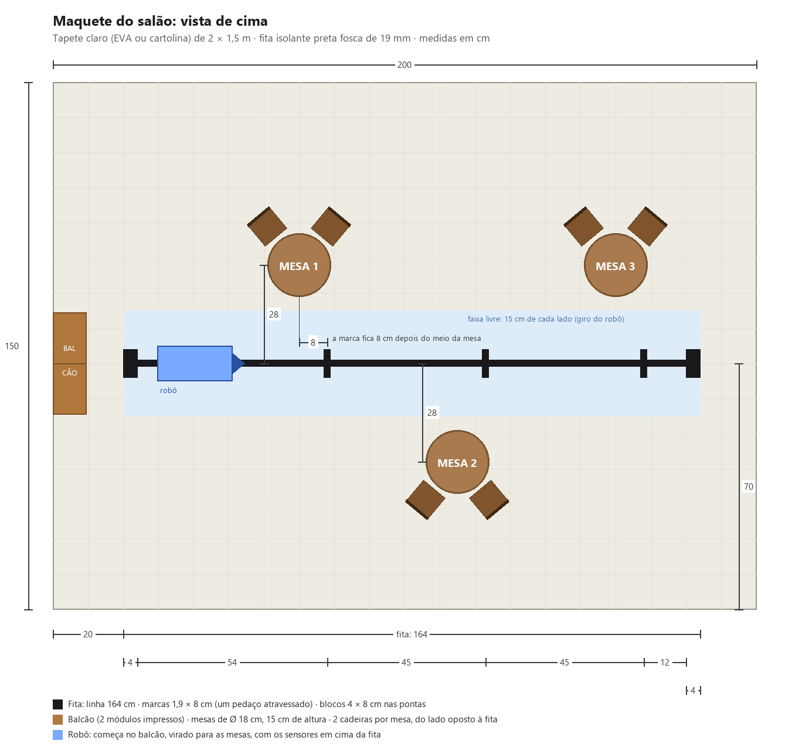

# 🧭 Guia Passo a Passo: do zero ao robô andando

Este é o **roteiro principal** do projeto. Siga na ordem, sem pular fases.

```
FASE 1: Software        →   FASE 2: Compras            →   FASE 3: Montagem          →   FASE 4: Portfólio
(sem gastar nada,           (uma peça de cada vez,          (só depois que TUDO             (vídeo, fotos,
 tudo no seu PC)             conferindo cada uma)            chegou)                         GitHub)
```

Depois do robô pronto no modo manual vem a **FASE 5: Autonomia** (planejada): o robô recebe pedidos pelo celular e vai sozinho até a mesa, seguindo uma linha no chão.

Os outros documentos são **consulta** e este guia indica quando abrir cada um:

| Documento | Para quê |
|---|---|
| `lista_compras_detalhada.md` | Especificação técnica e preço de cada peça |
| `manual_montagem_fisica.md` | Instruções detalhadas de montagem e fiação |
| `CLAUDE.md` | Referência técnica: comandos, pinos, API |

---

# FASE 1: Software e ambiente de desenvolvimento

> 🎯 **Objetivo:** ter o firmware compilando e ver o robô funcionando **num simulador no seu PC** antes de comprar qualquer peça.
> ⏱️ Tempo: 1 a 2 horas.

## Passo 1.1: Ferramentas instaladas ✅ (já feito)

Estas ferramentas já foram instaladas no seu computador:

| Ferramenta | Para que serve | Onde ficou |
|---|---|---|
| **VS Code** | Editor onde você vai ler e editar o código | Menu Iniciar → "Visual Studio Code" |
| **Extensão PlatformIO** | Compila o código e envia para a placa ESP32 | Ícone de formiga 🐜 na barra lateral do VS Code |
| **Python 3.12** | O PlatformIO precisa dele por baixo dos panos | Você não vai mexer nele |
| **Compilador ESP32** | Transforma o C++ em programa para o chip | Baixado pelo PlatformIO em `%USERPROFILE%\.platformio` (ex.: `C:\Users\<seu usuário>\.platformio`) |
| **Node.js** (você já tinha) | Roda o simulador | — |

O firmware já foi **compilado com sucesso** uma vez:
```
RAM:   [==        ]  16.3% (used 53420 bytes from 327680 bytes)
Flash: [=====     ]  46.6% (used 916145 bytes from 1966080 bytes)
[SUCCESS]
```
Ou seja, o código não tem erros e cabe com folga na placa.

## Passo 1.2: Abrir o projeto no VS Code

1. Abra o **Visual Studio Code** pelo Menu Iniciar.
2. Na primeira abertura, a extensão PlatformIO termina de se configurar sozinha. Aparece "PlatformIO: Installing..." no canto inferior direito. **Espere** até sumir (2 a 5 minutos). Se ele pedir para recarregar a janela (*Reload Now*), clique em sim.
3. Menu **File → Open Folder...** → navegue até a pasta do projeto (ex.: `C:\Users\<seu usuário>\Projects\robo-garcom-iot`) → **Selecionar pasta**.
4. Se aparecer "Do you trust the authors of the files in this folder?", clique em **Yes, I trust the authors**.
5. No painel da esquerda (Explorer) você verá as pastas `src/`, `simulador/` e os arquivos `.md`.

> 💡 Arquivos `.md` ficam mais legíveis com **Ctrl+Shift+V** (pré-visualização formatada).

## Passo 1.3: Compilar o firmware pelo VS Code

1. Olhe a **barra azul na parte de baixo** do VS Code. Ela tem pequenos ícones do PlatformIO:
   - **✓** (Build) compila
   - **→** (Upload) envia para a placa (só na Fase 3)
   - **🔌** (Serial Monitor) mostra as mensagens da placa (só na Fase 3)
2. Clique no **✓**. Um terminal abre embaixo e, em segundos, aparece **`[SUCCESS]`** em verde.
3. Se aparecer `[FAILED]`, leia as linhas em vermelho: elas dizem o arquivo e a linha do erro.

**Experimento:** abra `src/config.h`, troque `"RoboGarcom-IoT"` (nome da rede Wi-Fi) por `"MeuRobo"`, salve com **Ctrl+S** e compile de novo. Depois volte ao nome original. Você acabou de modificar um firmware de hardware!

## Passo 1.4: Rodar o simulador

O simulador imita a ESP32-CAM no seu PC: **o mesmo painel, os mesmos comandos e a mesma parada de segurança**. No lugar da câmera, ele mostra o "salão" em miniatura visto de cima: um tapete de 2 × 1,5 m com uma linha reta de fita preta, o balcão (B), as mesas 1, 2 e 3 e o robô no tamanho real.

1. No VS Code: menu **Terminal → New Terminal**.
2. Digite (Enter após cada linha):
   ```
   cd simulador
   npm start
   ```
   > A primeira vez já foi preparada (`npm install`). Se um dia aparecer erro de módulo faltando, rode `npm install` antes.

   > ⚠️ Se aparecer *"npm.ps1 não pode ser carregado porque a execução de scripts foi desabilitada"*, é uma trava do PowerShell, não do projeto. Use **`npm.cmd start`** (e `npm.cmd install`) no lugar de `npm`. Ou, para liberar de vez só para o seu usuário: `Set-ExecutionPolicy -Scope CurrentUser -ExecutionPolicy RemoteSigned`, responda **S**, feche e reabra o terminal.
3. Aparece:
   ```
   === Robo Garcom IoT - SIMULADOR ===
     Abra no navegador:  http://localhost:8080
   ```
4. Abra o navegador em **http://localhost:8080**.
5. Teste:
   - **Segure** ▲ e o robô (fica verde) anda para frente. Solte e ele para.
   - Use **W A S D** ou as **setas** do teclado. Segure duas juntas (ex.: **W + D**) para fazer uma **curva**; os botões dos cantos (◤ ◥ ◣ ◢) fazem o mesmo.
   - Mude a **velocidade** no controle deslizante.
   - Clique em **💡 Flash**: a "imagem" fica mais clara.
   - Veja o terminal: cada comando aparece como no monitor serial do robô de verdade.
6. **Teste de segurança:** segure ▲ e, sem soltar, clique fora da janela do navegador. O robô para. É a proteção "homem-morto" que também existe no robô real.
7. Para encerrar o simulador: clique no terminal e aperte **Ctrl + C**.

**Experimentos:**
- Em `src/config.h`, mude `MOTOR_MAX_DUTY` de `180` para `120`. Encerre (Ctrl+C) e rode `npm start` de novo: o robô fica mais lento. O simulador lê os mesmos valores do firmware.
- Em `src/dashboard_html.h`, troque `--acc:#3ea6ff` (azul dos botões) por `--acc:#ff8c00` (laranja). Salve e aperte **F5** no navegador.

Volte os valores ao original depois.

## Passo 1.5: Entender o código (ordem de leitura recomendada)

Leia com calma, nesta ordem. Os comentários no código estão em português.

| # | Arquivo | O que você vai aprender |
|---|---|---|
| 1 | `src/config.h` | Todas as "configurações" do robô: nome do Wi-Fi, quais pinos ligam nos motores, qualidade da câmera, limites de velocidade |
| 2 | `src/main.cpp` | O "roteiro" do robô: `setup()` roda **uma vez** ao ligar (inicia motores, câmera, Wi-Fi e servidores); `loop()` roda **para sempre** (checa atualizações e a parada de segurança) |
| 3 | `src/motors.cpp` | Como girar um motor para frente ou para trás e controlar a velocidade com PWM |
| 4 | `src/camera.cpp` | Como a câmera é configurada |
| 5 | `src/web_server.cpp` | Como o robô responde quando o navegador pede `/cmd?dir=forward` e como o vídeo é enviado quadro a quadro |
| 6 | `src/dashboard_html.h` | A página web (HTML + CSS + JavaScript) que você vê no navegador |
| 7 | `simulador/server.js` | O "robô de mentira" em JavaScript, que imita tudo acima |

> 💡 Ficou com dúvida em algum trecho? Abra o Claude Code na pasta do projeto e pergunte, por exemplo: *"explique a função applyLocked em motors.cpp linha por linha"*.

## Passo 1.6: Versionamento com Git ✅ (já feito)

O projeto já é um repositório Git com o primeiro commit. Para publicar no **GitHub** (recomendado para portfólio):
1. Crie uma conta em https://github.com, se ainda não tiver.
2. Clique em **New repository** → nome `robo-garcom-iot` → **Public** → *não* marque "Add README" → **Create**.
3. Peça ao Claude Code: *"publique o projeto robo-garcom-iot no meu GitHub"*, ou siga os comandos que o GitHub mostra na tela ("…or push an existing repository").

## ✅ Checkpoint da Fase 1

Só avance quando todos estiverem marcados:
- [ ] Abri o projeto no VS Code
- [ ] Compilei pelo botão ✓ e vi `[SUCCESS]`
- [ ] Rodei o simulador e controlei o robô virtual pelo navegador
- [ ] Testei a parada de segurança (clicar fora da janela segurando ▲)
- [ ] Li pelo menos `config.h` e `main.cpp`

---

# FASE 2: Compras

> 🎯 **Objetivo:** comprar **todas** as peças e conferir cada uma quando chegar.
> 🚫 **Não comece a montar** até a Fase 2 estar 100% concluída.

### Onde comprar

| Loja | Vantagem | Desvantagem |
|---|---|---|
| **Mercado Livre** | Chega em 1 a 5 dias, devolução fácil | 30 a 80% mais caro |
| **AliExpress** | Bem mais barato | Demora 10 a 40 dias e a devolução é trabalhosa |
| Loja física de eletrônica | Você vê a peça antes | Nem sempre tem tudo |

**Sugestão:** faça tudo pelo Mercado Livre se quiser começar logo, ou tudo pelo AliExpress se quiser economizar e não tiver pressa. Juntar vários itens do **mesmo vendedor** economiza frete.

Detalhes técnicos de cada item: `lista_compras_detalhada.md`.

---

### 🛒 Compra 1: Placa ESP32-CAM com base programadora
- **Termo de busca:** `ESP32-CAM-MB OV2640 kit`
- **No anúncio, confira:** "ESP32-CAM" + "**MB**" (a base com USB) + câmera "**OV2640**". Se o anúncio for só "ESP32-CAM" sem MB, **não compre**: você precisaria de outro adaptador.
- **Quantidade:** 1 kit (ou 2, se puder; ver a dica no fim).
- **Preço:** R$ 45 a 75 por kit.
- **Quando chegar:** 3 peças (placa ESP32-CAM, câmera com fita flat, base MB com conector USB). A câmera pode vir já encaixada. Guarde na embalagem antiestática.

### 🛒 Compra 2: Cabo USB de dados
- **Qual tipo:** olhe a foto da base MB do anúncio da Compra 1. O conector é **Micro-USB** ou **USB-C**.
- **Termo de busca:** `cabo micro usb dados` (ou `cabo usb-c dados`).
- **Importante:** precisa ser **de dados**. Muitos cabos que vêm com fone ou power bank **só carregam**. Se você já tem um cabo que transfere fotos do celular para o PC, ele serve.
- **Preço:** R$ 10 a 20.

### 🛒 Compra 3: Kit chassi 2WD (motores e rodas)
- **Termo de busca:** `kit chassi 2wd robo arduino acrilico`
- **No anúncio, confira:** 2 motores amarelos com redução (TT, 3–6 V), 2 rodas, **1 roda boba**, chassi de acrílico e parafusos. De preferência com "**motores com fios soldados**".
- **Preço:** R$ 45 a 80.
- **Quando chegar:** conte as peças pela foto do anúncio. Teste cada motor encostando os 2 fios numa pilha AA comum: ele deve girar.

### 🛒 Compra 4: Driver de motor (ponte H)
- **Termo de busca:** `MX1508 ponte h`. Alternativa: `L9110S ponte h`.
- **No anúncio, confira:** de preferência **com pinos já soldados**.
- **Preço:** R$ 8 a 15.
- **Quando chegar:** confira os nomes impressos: IN1, IN2, IN3, IN4, MOTOR-A, MOTOR-B e alimentação (+/−).

### 🛒 Compra 5: Regulador de tensão LM2596
- **Termo de busca:** `LM2596 step down display`
- **Preço:** R$ 10 a 20. A versão **com display** mostra a tensão e facilita muito.
- **Quando chegar:** tem um cubinho azul com parafuso (trimpot) e bornes IN+/IN−/OUT+/OUT−.

### 🛒 Compra 6: Suporte de baterias
- **Termo de busca:** `suporte 2 baterias 18650 com chave`
- **No anúncio, confira:** "2x18650", "**em série**" e "**com chave liga/desliga**".
- **Preço:** R$ 8 a 15.

### 🛒 Compra 7: Baterias 18650 (2 unidades)
- **Termo de busca:** `bateria 18650 samsung` (ou LG, Sony, Panasonic)
- **Fuja de:** anúncios com "9800 mAh" ou "12000 mAh". **Não existem.** São baterias falsas e perigosas. O real fica entre 2000 e 3500 mAh.
- **Preço:** R$ 15 a 40 cada.
- **Quando chegar:** confira se encaixam no suporte da Compra 6.

### 🛒 Compra 8: Carregador de 18650
- **Termo de busca:** `carregador 18650 2 slots inteligente` (ex.: Liitokala Lii-202)
- **Preço:** R$ 30 a 70.

### 🛒 Compra 9: Jumpers e mini protoboard
- **Termo de busca:** `kit jumper 120 peças macho femea 20cm` e `mini protoboard 170 pontos`
- **No anúncio, confira:** os 3 tipos (macho-macho, fêmea-fêmea, macho-fêmea).
- **Preço:** R$ 15 a 30 (jumpers) + R$ 4 a 10 (protoboard).

### 🛒 Compra 10: Componentes passivos
Geralmente vendidos em kits ou pacotes de 10. Pode comprar em loja física.
- **Resistor 10 kΩ 1/4 W**: `resistor 10k 1/4w`
- **Capacitor eletrolítico 470 µF 16 V** (ou 1000 µF): `capacitor eletrolitico 470uf 16v`
- **Capacitor cerâmico 100 nF** (marcado "104"): `capacitor ceramico 104`
- **Preço:** R$ 5 a 10 no total.

### 🛒 Compra 11: Ferramentas
- **Multímetro digital (OBRIGATÓRIO):** `multimetro digital dt830`, R$ 30 a 60. Sem ele não dá para ajustar o regulador com segurança.
- **Chaves de fenda e Phillips pequenas** (kit de precisão), R$ 10 a 20.
- **Ferro de solda 30–60 W + estanho**, R$ 30 a 60. Necessário se os motores vierem sem fios ou o driver sem pinos.
- **Fita dupla-face espessa + abraçadeiras plásticas**, R$ 10 a 20.

> 💡 **Dica:** compre **2 kits ESP32-CAM**. É muito comum vir uma com defeito ou queimar uma por engano no primeiro projeto. Com uma reserva, você não fica 30 dias parado esperando outra chegar.

## ✅ Checkpoint da Fase 2

Marque conforme cada peça chegar **e passar na conferência**:
- [ ] 1. Kit ESP32-CAM + base MB + câmera OV2640
- [ ] 2. Cabo USB de dados
- [ ] 3. Kit chassi (2 motores testados com pilha, 2 rodas, roda boba)
- [ ] 4. Driver MX1508 (ou L9110S)
- [ ] 5. Regulador LM2596
- [ ] 6. Suporte 2×18650 com chave
- [ ] 7. 2 baterias 18650 (3,6 a 4,2 V cada, medidas no multímetro)
- [ ] 8. Carregador de 18650
- [ ] 9. Jumpers (3 tipos) + mini protoboard
- [ ] 10. Resistor 10 kΩ, capacitor 470 µF, 2 capacitores 100 nF
- [ ] 11. Multímetro, chaves, ferro de solda (se precisar), fita e abraçadeiras

**Antes de passar para a Fase 3:** carregue as 2 baterias no carregador (algumas horas).

---

# FASE 3: Montagem

> 🎯 **Objetivo:** montar o robô e vê-lo andando com vídeo ao vivo.
> Abra o **`manual_montagem_fisica.md`** e siga as etapas abaixo **nesta ordem**.
> ⏱️ Tempo: 3 a 5 horas. Pode dividir em vários dias; cada etapa termina num ponto seguro de pausa.

| Ordem | Etapa do manual | O que você faz | Precisa de |
|---|---|---|---|
| 3.1 | **Etapa 0** | Ler os conceitos de eletrônica (sem mexer em nada) | — |
| 3.2 | **Etapa 1** | Só conferir o driver USB (CH340); o resto já foi feito na Fase 1 | Compras 1 e 2 |
| 3.3 | **Etapa 2** | Gravar o firmware na placa pelo USB e ver o vídeo **real** no celular | Compras 1 e 2 |
| 3.4 | **Etapa 3** | Montar o chassi (motores, rodas, roda boba) | Compra 3, chaves |
| 3.5 | **Etapa 4** | Preparar os motores (fios e capacitores 100 nF) | Ferro de solda, capacitores |
| 3.6 | **Etapa 5** | Baterias e **ajuste do LM2596 para 5,0 V** ⚠️ | Compras 5–7, multímetro |
| 3.7 | **Etapa 6** | Barramentos de energia na protoboard | Protoboard, jumpers, capacitor 470 µF |
| 3.8 | **Etapa 7** | Ligar o driver e os motores | Compra 4 |
| 3.9 | **Etapa 8** | Ligar a ESP32-CAM (sinais, resistor 10 kΩ, alimentação) | Resistor 10 kΩ |
| 3.10 | **Etapa 9** | **Revisão com multímetro antes de ligar** ⚠️ | Multímetro |
| 3.11 | **Etapa 10** | Primeira ligação com as rodas no ar | — |
| 3.12 | **Etapa 11** | Calibrar a direção dos motores e da câmera | — |
| 3.13 | **Etapa 12** | Aprender a atualizar o firmware pelo Wi-Fi | — |

Se algo der errado em qualquer etapa: **Etapa 13** do manual (tabela de problemas e soluções).

## ✅ Checkpoint da Fase 3
- [ ] Vi o vídeo real da câmera no celular (Etapa 2)
- [ ] LM2596 marca 5,0 V (Etapa 5)
- [ ] Revisão com multímetro sem nenhum curto (Etapa 9)
- [ ] Robô liga e o LED vermelho fica aceso fixo (Etapa 10)
- [ ] Frente, trás, esquerda e direita corretos (Etapa 11)
- [ ] Atualizei o firmware pelo Wi-Fi pelo menos uma vez (Etapa 12)

---

# FASE 4: Portfólio

Veja a **Etapa 14** do manual. Resumo:
1. Grave um vídeo de 30 a 60 s: o robô andando + a tela do celular com o vídeo ao vivo.
2. Inclua também um trecho do **simulador**. Ele mostra que você projetou e testou o software antes do hardware, o que é uma boa prática de engenharia.
3. Fotografe a fiação antes de fechar o chassi.
4. Publique no GitHub (Passo 1.6) e escreva no README as decisões de engenharia.

---

# FASE 5: Autonomia: o garçom que anda sozinho (planejada)

> **Só comece depois do Checkpoint da Fase 3** (robô funcionando no modo manual pelo celular). Nada desta fase muda a montagem da Fase 3: ela só **acrescenta** peças.

**Objetivo (nível 3, escolhido pelo dono em 2026-10-14):** pela página no celular, alguém faz o pedido para uma mesa. O robô sai do balcão (base) seguindo uma **fita preta no chão**, para na mesa certa, **vira de frente para ela**, **avisa pelo alto-falante** e espera o cliente apertar o **botão verde**. Depois vira para o balcão e volta pela mesma linha. O modo manual pelo celular continua existindo.

### Decisões já tomadas
- **Segundo cérebro:** uma **ESP32 DevKit** cuida dos motores e dos sensores. A ESP32-CAM fica só com o vídeo, o Wi-Fi e a página de pedidos. Motivo: a ESP32-CAM não tem pinos livres para sensores. As duas placas conversam por 2 fios (serial).
- **Uma linha reta + meia-volta** (decisão do dono em 2026-10-14; antes era um circuito fechado). Na ida, o robô conta as marcas (1, 2, 3) e para na marca da mesa pedida. Na volta, conta as marcas para baixo até o balcão, onde gira 180° e fica virado para as mesas.
  - **Como ele sabe que deu meia-volta, sem medir o ângulo:** os sensores ficam 13,5 cm à frente do eixo das rodas. Girando em volta do eixo, eles saem da fita e só caem nela de novo depois de 180°, apontando para o outro lado.
- **Virar de frente para a mesa + voz** (decisão do dono em 2026-10-16; testado no simulador). Na mesa, a meia-volta foi dividida em **dois giros de 90° no mesmo sentido**, cada um terminando numa fita:
  1. Na marca da mesa, o robô gira **para o lado da mesa** até o sensor do meio achar o **ramal**: um traço curto de fita que sai da linha em direção à mesa. Pronto: ele está de frente para ela.
  2. O **alto-falante** toca a mensagem da mesa ("Mesa 2, seu pedido chegou! Retire da bandeja e aperte o botão verde."). Se ninguém apertar, repete a cada 20 s.
  3. Com o **botão verde** apertado, ele continua girando **no mesmo sentido** por mais 90°, até o sensor do meio achar a **linha**. Agora ele está virado para o balcão e volta normalmente.
  - **Por que o ramal fica 13,5 cm ANTES da marca:** o robô para quando a **barra de sensores** chega na marca, e nessa hora o **eixo das rodas** (o ponto em volta do qual ele gira) está 13,5 cm para trás. O ramal precisa sair exatamente dali.
  - **Por que o ramal começa a 5 cm da linha, e não colado nela:** enquanto segue a fita, os sensores das pontas da barra ficam a até ~2,5 cm da linha. Com o espaço de 5 cm, eles nunca veem o ramal e o robô não se confunde (nem entorta, nem conta uma marca a mais).
  - **Por que funciona sem medir ângulo:** girando no lugar, o sensor do meio desenha um círculo de 13,5 cm de raio. Ele só cruza o ramal (que vai de 5 a 17 cm da linha) quando o robô está apontando para a mesa.
  - **Peças a mais:** DFPlayer Mini + alto-falante + botão verde, todos ligados na ESP32 DevKit (veja "Ligações do alto-falante e do botão", abaixo).
  - **Giro suave:** em pulsos (liga/desliga os motores rapidinho), porque a menor velocidade dos motores ainda é rápida e poderia derrubar o que está na bandeja.
  - **Espaço para girar:** o giro "varre" um círculo de ~29 cm de diâmetro em volta do eixo das rodas (a ponta da frente fica a ~14,5 cm do eixo, com a base do kit das fotos). **Mesas, cadeiras e pés de pessoas precisam ficar a pelo menos ~15 cm da fita.**
  - **Pontas da linha:** um bloco de fita (4 × 8 cm) no balcão e outro no fim da linha. Se a fita simplesmente acabasse, o robô acharia que se perdeu.
  - **Onde vai a barra de sensores:** o rodízio do kit (roda boba giratória) fica no meio da frente, embaixo da base, justamente onde a barra de 5 sensores ficaria. A barra vai precisar de um suporte que a deixe **na frente do rodízio** (saindo um pouco da base), a 5–10 mm do chão. Resolver no Passo 5.4, com a base em mãos.

```
                [MESA 1]                     [MESA 3]
                   ┃                            ┃
                   ┃ ramal                      ┃ ramal

 [BALCÃO] ■━━━━━━━━━━━━━┿━━━━━━━━━━━━━━━━━━━━━━━━━┿━━━━━━━━━━━━━━━━■ fim
                   ↑ 13,5 ↑         ┃ ramal     ↑ 13,5 ↑
                  eixo   marca      ┃          eixo   marca
                                 [MESA 2]

 ■ = bloco de ponta (4 × 8 cm)   ┿ = marca da mesa (fita atravessada, 8 cm)
 ┃ = ramal (fita de 12 cm, de 5 a 17 cm da linha, 13,5 cm ANTES da marca, do lado da mesa)
```

### Como montar a maquete (o "salão" em miniatura)

As medidas são as mesmas do simulador: o robô de verdade encontra a mesma pista que já foi testada no PC.




1. **Tapete:** forre uma área de **2 m × 1,5 m** com EVA ou cartolina **clara** (o contraste com a fita preta é o que os sensores enxergam). Prenda as emendas por baixo, para não ficar degrau.
2. **Linha:** a 20 cm da borda esquerda e a **70 cm da borda de baixo**, cole uma tira reta de **fita isolante preta fosca de 164 cm**. Dica: estique um barbante ou use uma régua comprida como guia, e cole a fita esticada, sem bolhas.
3. **Blocos das pontas:** em cada ponta da linha, cole um bloco de **4 × 8 cm** (dois pedaços de fita lado a lado, atravessados). O da esquerda é o **balcão**; o da direita é o **fim da linha** (segurança).
4. **Marcas das mesas:** um pedaço de fita de **8 cm atravessado** na linha (forma uma cruz), medindo a partir do bloco do balcão: **54 cm** (mesa 1), mais **45 cm** (mesa 2), mais **45 cm** (mesa 3). Sobram 12 cm até o bloco de fim.
5. **Ramais (para o robô virar de frente para a mesa):** para cada mesa, um pedaço de fita de **12 cm**, **em pé** (perpendicular à linha), **do lado da mesa**:
   - **onde:** **13,5 cm antes** da marca da mesa (do lado do balcão);
   - **começo:** a **5 cm** da linha (deixe esse espaço vazio, sem fita); **fim:** a **17 cm** da linha;
   - mesas 1 e 3: o ramal vai para o lado delas; mesa 2: para o outro lado;
   - **⚠️ confira com o robô montado:** os 13,5 cm são a distância entre a **barra de sensores** e o **eixo das rodas**. Meça no seu robô e use a sua medida. Alguns milímetros a mais ou a menos não atrapalham: o robô só fica um pouquinho de lado para a mesa.
6. **Balcão:** encostado na ponta esquerda, com ~28 cm de comprimento e ~17 cm de altura. Dá para **imprimir em 3D** (2 módulos ripados e econômicos, pasta `maquete/`) ou usar uma caixa.
7. **Mesas:** **15 cm de altura e ~18 cm de tampo** (na proporção do robô: o tampo fica entre as duas bandejas). Dá para **imprimir em 3D** (pasta `maquete/`, veja o `LEIA-ME.md` de lá) ou usar qualquer objeto parecido (pote, lata, caixa). Se tiver **cadeiras** (também na pasta `maquete/`), coloque 2 por mesa, **do lado oposto à fita**. O **meio** de cada mesa fica a **28 cm da linha** e **8 cm antes** da marca dela. Mesas 1 e 3 de um lado, mesa 2 do outro.
8. **Faixa livre:** deixe **15 cm livres de cada lado da fita** (sem pés de mesa, cadeiras ou objetos), porque o robô gira no lugar no balcão e nas mesas. Os ramais ficam dentro dessa faixa, e tudo bem: são só fita no chão.
9. **Robô:** coloque-o no balcão, **virado para as mesas**, com a barra de sensores em cima da fita, logo depois do bloco.

> Testando no simulador antes? A página http://localhost:8080/pedidos mostra exatamente esta pista vista de cima, com os ramais. As imagens `maquete_cima.png` e `maquete_angulo.png` acima ainda são de **antes** dos ramais; o `maquete/step/maquete_completa.step` já tem os ramais.

### Ligações do alto-falante e do botão (planejado; tudo na ESP32 DevKit)

A ESP32-CAM não tem pinos livres, então tudo vai na **ESP32 DevKit** (o "segundo cérebro"). É ela que sabe quando o robô chegou na mesa.

| Peça | Pino da peça | Liga em | Observação |
|---|---|---|---|
| **DFPlayer Mini** | VCC | 5 V (saída do LM2596) | Não use o 3V3: o som fica fraco e falha |
| | GND | GND comum | |
| | RX | DevKit **GPIO17** (TX2), **com um resistor de 1 kΩ no meio** | O resistor evita chiado e protege o módulo |
| | TX | DevKit **GPIO16** (RX2) | |
| | SPK_1 / SPK_2 | os 2 fios do **alto-falante** (8 Ω, 0,5 a 3 W, 28 a 40 mm) | O amplificador já vem no módulo. **Não** ligue o alto-falante no GND |
| **Botão verde** (push button 12 mm de painel; o arcade de 30 mm é grande demais para a cabeça) | um terminal | DevKit **GPIO27** | O código liga o resistor interno (`INPUT_PULLUP`): solto = 1, apertado = 0 |
| | outro terminal | GND | |

- **Cartão microSD do DFPlayer** (até 32 GB, FAT32): crie uma pasta `mp3` e, dentro dela, um arquivo por mesa: `0001.mp3` = "Mesa 1, seu pedido chegou! Retire da bandeja e aperte o botão verde.", `0002.mp3` = mesa 2, `0003.mp3` = mesa 3. Dá para gravar com a sua voz pelo celular ou gerar com uma voz do Windows (o Claude pode gerar os arquivos).
- **Os pinos 16, 17 e 27 são uma sugestão**, porque estão livres na DevKit e não atrapalham o boot. A tabela definitiva vai para o `config.h` no Passo 5.2, junto com a dos sensores.
- **Onde montar:** alto-falante virado para a frente, na saia ou na cabeça (precisa de furinhos na carcaça); botão verde em cima, num lugar fácil para o cliente apertar. A carcaça ainda **não** tem esses furos.

### Degraus (cada um funciona sozinho)

| Passo | O que fazer | Peças | Dificuldade |
|---|---|---|---|
| 5.1 | ✅ **No simulador (antes das peças):** salão virtual com a linha reta, 3 mesas, meia-volta e a página de pedidos. Pronto em 2026-10-14 (veja abaixo) | — | ⭐ |
| 5.2 | Ligar a ESP32 DevKit e passar os motores para ela | ESP32 DevKit | ⭐⭐ |
| 5.3 | **Freio automático:** parar se algo aparecer na frente (vale também no modo manual) | VL53L0X + janelinha na frente da saia | ⭐ |
| 5.4 | **Seguir a linha** (linha reta de fita isolante) | Barra de 5 sensores TCRT5000 + fita | ⭐⭐⭐ |
| 5.5 | **Parar na marca N**, **virar de frente para a mesa** (ramal), depois virar para o balcão e voltar | Marcas e ramais na fita | ⭐⭐⭐ |
| 5.6 | **Pedidos pelo celular** + **botão verde** no robô + **mensagem no alto-falante** | DFPlayer Mini + alto-falante + botão | ⭐⭐ |

Tempo estimado: **~4 a 5 fins de semana**, contando a partir do robô manual pronto. O mais trabalhoso é ajustar o 5.4 (testes com o robô no chão).

As peças extras estão em `lista_compras_detalhada.md`, seção 5. **Ainda não compre:** espere o Checkpoint da Fase 3.

### Passo 5.1: testar o garçom autônomo no simulador ✅

1. Rode o simulador como no Passo 1.4 (`cd simulador` e depois `npm start`, ou `npm.cmd start`).
2. Abra **http://localhost:8080/pedidos** (a página de controle manual continua em http://localhost:8080).
3. Em **🤖 Robô**, toque em **🚚 Automático**. O robô já começa na base.
4. Em **🍽️ Mesa**, escolha uma mesa e os itens e toque em **Enviar pedido**.
5. Em **👩‍🍳 Cozinha**, toque em **✔ Pronto**. O robô sai sozinho, segue a fita, conta as marcas e para na mesa.
6. Toque em **✅ Entregue**. Ele dá meia-volta (fica roxo), volta pela linha até o balcão, gira de novo e pega o próximo pedido pronto, se houver.
7. Teste o freio: toque em **🚧 Obstáculo na pista** (uma "pessoa" aparece na linha, entre as mesas 1 e 2). O robô para na frente dela e continua quando você tira o obstáculo.
8. Teste o controle manual: com o robô andando sozinho, segure uma seta na página de controle manual. O humano assume, e o pedido volta para a fila. Para voltar ao automático: **📍 Colocar na base** e depois **🚚 Automático**.

Na tela, os 5 pontinhos na frente do robô são os sensores de linha: ficam **vermelhos** quando estão em cima da fita. A cor do robô mostra o estado: azul = no balcão, verde = andando, amarelo = na mesa, roxo = meia-volta, vermelho = obstáculo ou perdido.

> O modo automático existe **só no simulador** por enquanto. O firmware do robô real ganha essas funções a partir do Passo 5.2, depois que as peças da Fase 5 chegarem.

## ✅ Checkpoint da Fase 5
- [ ] Bandejito virtual atendendo pedidos no simulador (5.1)
- [ ] Robô para sozinho diante de um obstáculo (5.3)
- [ ] Robô vai e volta pela linha sem sair dela (5.4)
- [ ] Robô para na mesa pedida, vira de frente para ela, depois vira para o balcão e volta (5.5)
- [ ] Pedido feito pelo celular; o robô fala a mensagem e volta quando o botão verde é apertado (5.6)

---

# FASE 6: Visão computacional (💭 só planejada, NÃO começar ainda)

> **Quando começar:** só depois do **Checkpoint da Fase 5 100% concluído**, com o garçom funcionando na fita. Decisão do dono, em 2026-10-14.

### A ideia
Fazer o robô **entender o que a câmera vê**: reconhecer pessoas e objetos, avisar quando algo está bloqueando o caminho e, mais para frente, talvez andar sem depender da fita.

### O que já sabemos (análise de 2026-10-14)
- **A ESP32-CAM não consegue reconhecer objetos sozinha.** Ela é como uma calculadora: vê e manda o vídeo, mas não "entende" a imagem. Quem entenderia é **o PC** (i5-9400 + GTX 1650 + 16 GB), recebendo o vídeo pelo Wi-Fi. O robô só "enxerga" com o PC ligado e perto.
- **Uma câmera só não mede distância direito.** Dá para estimar a distância de coisas apoiadas no chão (sabendo a altura e a inclinação da câmera), mas sempre será aproximada.
- **Os motores não contam as voltas** (não têm encoder). Sem isso, o robô não sabe quanto andou e não consegue montar um mapa.
- **O freio de verdade continua sendo o sensor VL53L0X** (Fase 5). A câmera ajuda, mas nunca deve ser a única segurança.
- O simulador mostra o salão **visto de cima**, não pelo "olho" do robô. Para testar a visão, seria preciso criar essa nova visão no simulador ou usar fotos e vídeos gravados.

### Degraus possíveis
| Passo | O que fazer | Peças / ferramentas | Dificuldade |
|---|---|---|---|
| 6.1 | **Só observar:** programa no PC (Python + OpenCV + IA de detecção) que mostra o vídeo com caixas em volta de pessoas e objetos. Não mexe nos motores | Nada novo (PC) | ⭐⭐ |
| 6.2 | **Distância aproximada + "chão livre"** (pela cor do tapete), calibrado com a câmera na cabeça | Nada novo | ⭐⭐⭐ |
| 6.3 | **Avisar o garçom:** a visão vira um "segundo par de olhos", junto do VL53L0X, para frear ou esperar | Nada novo | ⭐⭐⭐ |
| 6.4 | **Andar livre, sem fita** (mapa, desvio de obstáculos) | Seria quase outro robô: cérebro mais forte (ex.: Raspberry Pi 5), rodas com encoder, LiDAR ou câmera de profundidade. Valores a pesquisar na época | ⭐⭐⭐⭐⭐ |
| 6.5 | **Aprender sozinho** (aprendizado por reforço) | Projeto de pesquisa | ⭐⭐⭐⭐⭐ |

> Regras: a visão começa **só observando**; o firmware atual não muda; o programa de visão tem que poder ser desligado sem afetar nada. Licença: o YOLO da Ultralytics é AGPL (ok para portfólio aberto); alternativas mais livres: YOLOX, MobileNet-SSD.

## ✅ Checkpoint da Fase 6
- [ ] (Decidir quais degraus fazer quando chegar a hora)
