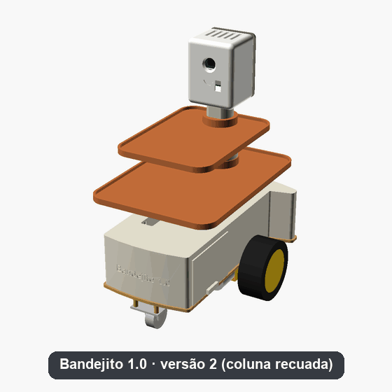
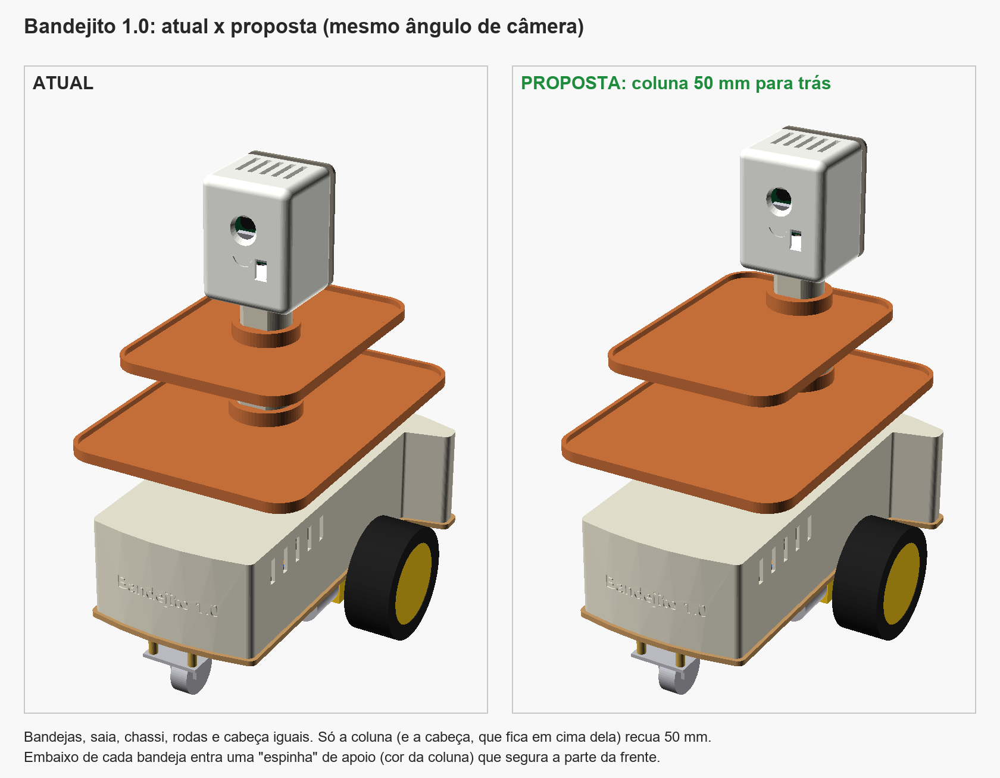

# 🤖 Bandejito 1.0: Robô Garçom IoT com Câmera


> 🚧 **Projeto em construção.** O software e o simulador estão prontos e testados; as peças do robô físico estão a caminho.

Protótipo em miniatura de um robô garçom controlado pelo navegador, com **vídeo ao vivo** e **controle em tempo real**, construído com uma **ESP32-CAM** de baixo custo (~R$ 250 em peças). A próxima etapa é transformá-lo num **garçom autônomo**, que segue uma fita no chão, para na mesa certa, dá meia-volta e volta para o balcão.

<p align="center">
  <br>
  <em>Modelo 3D completo, gerado por código a partir de um arquivo de medidas: portinhas, montagem peça por peça, fiação por dentro e chassi.</em>
</p>

<p align="center">
  <br>
  <em>O Bandejito na maquete impressa em 3D: leva o pedido à Mesa 2, freia e espera uma pessoa sair do caminho, entrega e volta ao balcão.</em>
</p>

## O que ele faz

- O robô cria a **própria rede Wi-Fi** e hospeda um painel web (não precisa de internet nem de app).
- **Vídeo MJPEG** da câmera direto numa tag ``.
- Controle por botões (toque/mouse) ou teclado (WASD/setas), com curvas, controle de velocidade e flash.
- **Parada de segurança automática** se a conexão cair, e **partida suave** (o robô alto não "empina" na arrancada).
- **Simulador** em Node.js: o mesmo painel e a mesma API, rodando no PC sem hardware.
- **Garçom autônomo (no simulador):** fila de pedidos pelo celular, seguidor de linha com 5 sensores, contagem de mesas, **giro de 90° para ficar de frente para a mesa**, **mensagem de voz** ("Mesa 2, seu pedido chegou!"), **botão verde** para o cliente confirmar, volta ao balcão e freio diante de obstáculos.
- **Carcaça impressa em 3D**, paramétrica, com bandejas e cabeça que abriga a câmera. Uma **versão 2** (em teste) recua a coluna para dar mais espaço nas bandejas.

## Telas

| Painel de controle (vídeo ao vivo + direção) | Página de pedidos (modo autônomo) |
|---|---|
|  |  |

As duas telas acima são do **simulador**: o painel é exatamente o mesmo HTML que roda dentro da ESP32-CAM.

## O que este projeto demonstra

- **Sistemas embarcados:** firmware C++ modular para ESP32 (câmera, PWM, servidor HTTP, OTA), com limites reais de hardware: poucos pinos, pinos de *strapping*, alimentação e consumo.
- **Concorrência e segurança:** dois servidores HTTP independentes, mutex FreeRTOS nos motores e parada automática ("homem-morto") se a conexão cair.
- **Web sem dependências:** painel responsivo em HTML/CSS/JS puro, servido pelo próprio robô, sem internet nem CDN.
- **Testar antes do hardware:** simulador em Node.js que reaproveita o HTML e os parâmetros do firmware e gera o vídeo MJPEG por software.
- **Controle e automação:** seguidor de linha com controle PD, máquina de estados e fila de pedidos (no simulador).
- **Modelagem 3D paramétrica:** carcaça gerada por código (CadQuery/OpenSCAD) a partir de um único arquivo de medidas.
- **Documentação:** guia passo a passo, manual de montagem pino a pino e decisões de engenharia registradas.

## Etapas do projeto

| Fase | Status |
|---|---|
| 1. Software: firmware, painel e simulador | ✅ Concluída |
| 2. Compra das peças | 🔄 Principais peças compradas (chassi, ESP32-CAM, driver, regulador, suporte das baterias) |
| 3. Montagem do robô controlado pelo celular | ⏳ |
| 3,5. Carcaça 3D | 🔄 Modelada (CadQuery/OpenSCAD); falta imprimir |
| 4. Portfólio: vídeo do robô real | ⏳ |
| 5. Garçom autônomo seguindo a fita | 🔄 Funcionando no simulador; falta o hardware |
| 6. Visão computacional no PC | 💭 Planejada |

## Decisões de engenharia

| Problema | Solução |
|---|---|
| O stream de vídeo nunca termina e bloquearia os comandos | Dois servidores HTTP (`esp_http_server`): vídeo na porta 81, controle na 80 |
| Wi-Fi cai com o robô andando | Failsafe "homem-morto": heartbeat de 200 ms no dashboard e parada automática após 600 ms no firmware |
| Motores derrubam a tensão e travam a câmera (brownout) | Alimentação separada: buck LM2596 5 V para a lógica, bateria direta no driver, capacitores de desacoplamento |
| ESP32-CAM tem pouquíssimos GPIOs livres | Mapeamento nos pinos do microSD (12–15), com pull-down de 10 kΩ no GPIO12 (strapping de tensão da flash) |
| Motores de 6 V com bateria de 8,4 V | Limite de duty cycle PWM (~70%) em vez de um segundo regulador |
| Conflito de PWM com o clock da câmera | Câmera no LEDC timer 0; motores nos canais 2–5 (timers 1–2) |
| Atualizar o firmware sem desmontar | OTA via Wi-Fi (partições `min_spiffs`) |
| Testar o software antes de ter o hardware | Simulador que reaproveita o HTML e os parâmetros do firmware |
| Autonomia sem pinos livres na ESP32-CAM | Planejada uma 2ª placa (ESP32 DevKit) para motores e sensores, ligada por serial |
| Navegação autônoma simples e confiável | Uma linha reta de fita: seguidor de linha PD + contagem de marcas (para cima na ida, para baixo na volta) para achar a mesa |
| Voltar pela mesma linha sem encoder nem giroscópio | Meia-volta no lugar: a barra de sensores fica 13,5 cm à frente do eixo, então ela só reencontra a fita depois de 180°. Giro em pulsos de PWM para não derrubar a bandeja |
| Ficar de frente para a mesa sem medir ângulo | Um "ramal" curto de fita, 13,5 cm antes da marca (sob o eixo): girando no lugar, o sensor do meio só o encontra depois de 90°. Mais 90° no mesmo sentido e ele volta à linha |
| Robô alto e leve "empina" na arrancada | Partida suave no firmware (rampa de PWM de 0,5 s; frear continua imediato), pilhas (a peça mais pesada) na frente e um pé antitombo na traseira |
| Mais espaço nas bandejas sem perder estabilidade | Versão 2: coluna 50 mm para trás, "espinhas" de apoio embaixo das bandejas e conta do centro de massa (validada no modelo 3D) |
| Carcaça que precisa se adaptar às medidas reais | Modelo paramétrico: um único `medidas.txt` gera STEP (Fusion 360), STL e o arquivo OpenSCAD |

## Carcaça 3D

<p align="center">
  
  
</p>

Detalhes em [`carcaca/LEIA-ME.md`](carcaca/LEIA-ME.md).

**Versão 2 (em teste):** coluna recuada, +71% de área livre na bandeja de baixo e o dobro na de cima. A versão original continua intacta em `carcaca/`; as diferenças e a análise de estabilidade estão em [`carcaca_v2_coluna_recuada/LEIA-ME.md`](carcaca_v2_coluna_recuada/LEIA-ME.md).

<p align="center">
  
</p>

## Estrutura

```
src/           firmware C++ (PlatformIO, Arduino core): camera, motors, web_server, dashboard
simulador/     robô virtual em Node.js (mesma API, vídeo gerado por software) + página de pedidos
carcaca/       carcaça 3D paramétrica (CadQuery + OpenSCAD), STEP, STL e bandejas de impressão (.3mf)
carcaca_v2_coluna_recuada/   versão 2 em teste: coluna recuada, pilhas na frente, pé antitombo
maquete/       "salão" em miniatura para imprimir em 3D: mesas, cadeiras e balcão econômico (paramétricos)
docs/          guia ilustrado da carcaça e imagens
*.md           guia passo a passo, lista de compras, manual de montagem
```

## Como rodar

**Simulador (sem hardware):**
```bash
cd simulador
npm install
npm start          # painel: http://localhost:8080 · pedidos: http://localhost:8080/pedidos
```

**Firmware (VS Code + PlatformIO):**
```bash
pio run -e esp32cam -t upload        # 1ª vez, via USB (base ESP32-CAM-MB)
pio run -e esp32cam_ota -t upload    # depois, via Wi-Fi
```
Conecte-se à rede `RoboGarcom-IoT` (senha `garcom1234`) e abra http://192.168.4.1.

> As senhas de Wi-Fi e OTA ficam em `src/config.h`. São padrões de demonstração: troque-as antes de usar o robô fora de casa.

Passo a passo completo: [`GUIA_PASSO_A_PASSO.md`](GUIA_PASSO_A_PASSO.md).

## Hardware

AI-Thinker ESP32-CAM (OV2640/OV3660) · driver MX1508 · 2 motores TT 3–6 V · chassi 2WD · 2× 18650 · buck LM2596.
Garçom autônomo (Fase 5): ESP32 DevKit · 5 sensores de linha TCRT5000 · sensor laser VL53L0X · DFPlayer Mini + alto-falante · botão verde.
Lista completa: [`lista_compras_detalhada.md`](lista_compras_detalhada.md) · Montagem: [`manual_montagem_fisica.md`](manual_montagem_fisica.md).

## Autor

**Rin&lt;code&gt;** · [github.com/rincode-dev](https://github.com/rincode-dev)

Aberto a oportunidades de **estágio**. Sugestões e perguntas sobre o projeto são bem-vindas nas [Issues](../../issues).

## Créditos

Desenvolvido com auxílio do [Claude Code](https://claude.com/claude-code) (IA da Anthropic) para programação e documentação.

## Licença

[MIT](LICENSE)
