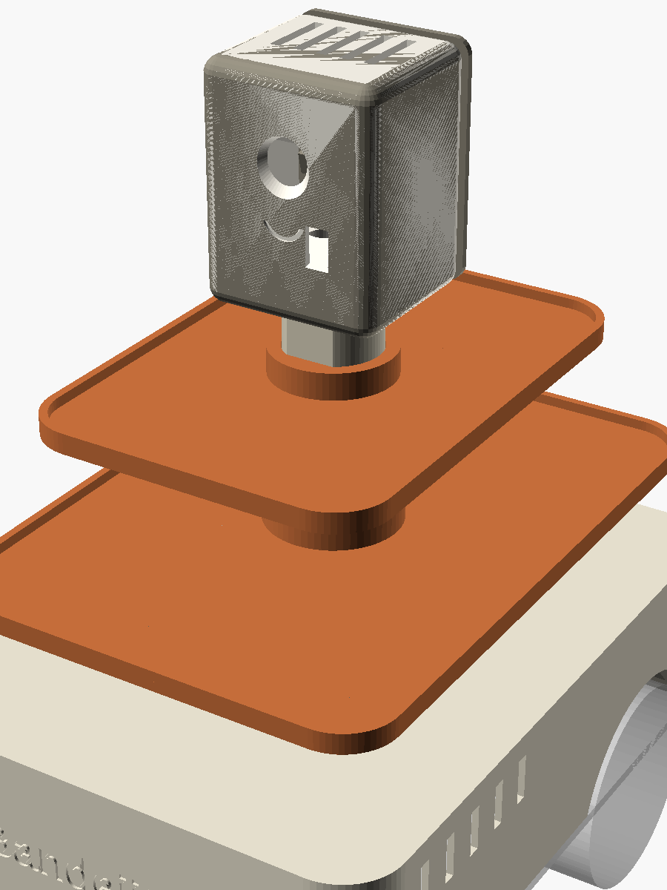
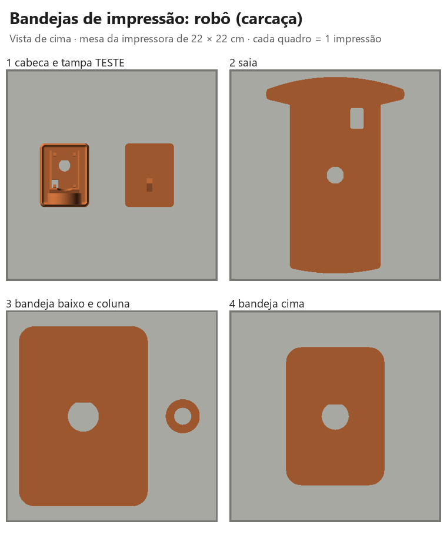
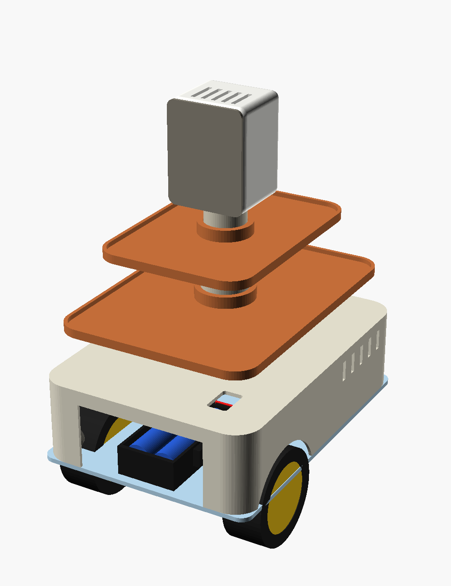
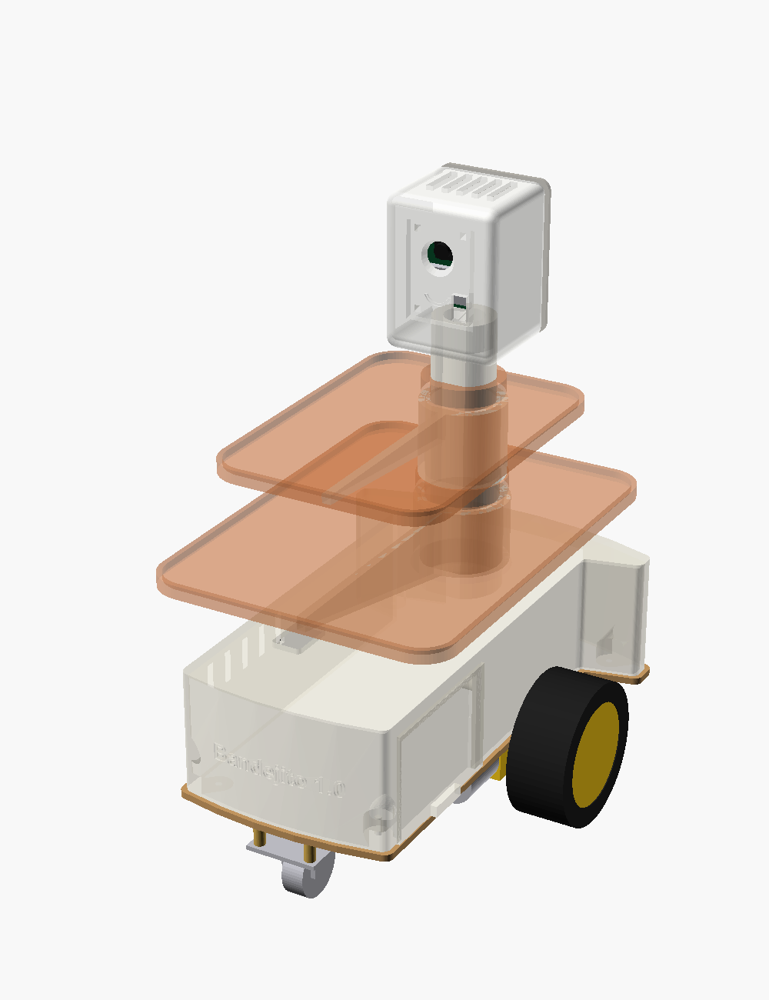
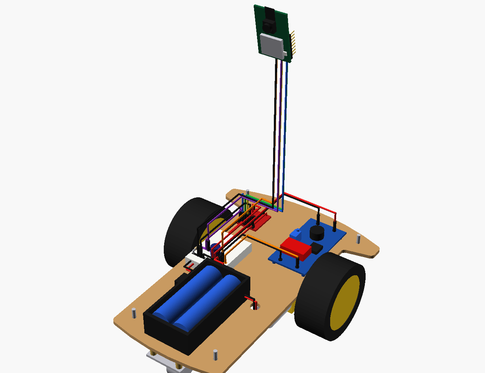
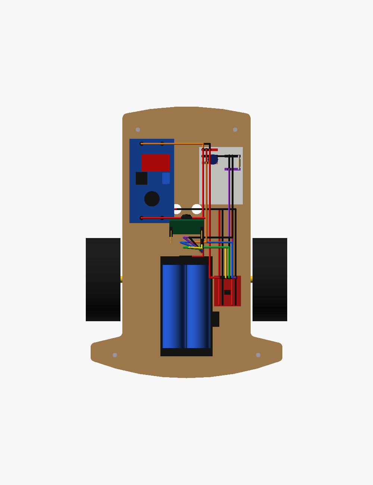
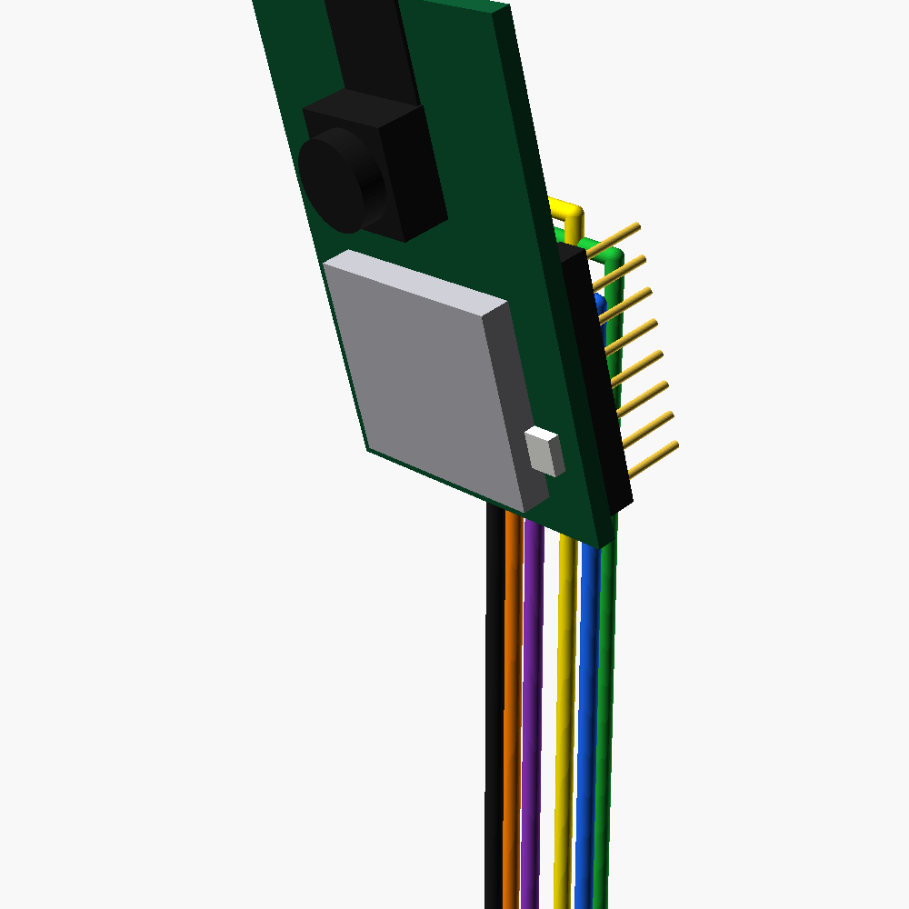

# Carcaça 3D: conceito B · Torre de Serviço

Modelo **paramétrico** em OpenSCAD: todas as medidas ficam em números que você muda no painel *Customizer*, sem mexer no código.

## Arquivos

| Arquivo | O que é |
|---|---|
| **`medidas.txt`** | **O painel de números.** Todas as medidas ficam aqui |
| **`GERAR.bat`** | Dois cliques: lê `medidas.txt` e gera tudo de novo (~10 s) |
| `step/*.step` | As 6 peças + `montagem.step` (robô inteiro) para o **Fusion 360** |
| `stl/*.stl` | As 6 peças avulsas para o fatiador (Cura, Bambu Studio, PrusaSlicer) |
| `impressao/` | **Bandejas prontas**: as peças já arrumadas na mesa da impressora (`.3mf` + `.stl`) |
| `bandeja_3mf.py` | Arruma as peças nas bandejas e grava os `.3mf` (usado também pela maquete) |
| `robo_garcom_carcaca.scad` | O mesmo modelo no OpenSCAD (o `GERAR.bat` copia as medidas para ele) |
| `gerar.py` | O programa que desenha as peças (CadQuery, Python) |
| `prototipo.py` | Monta o **protótipo demonstrativo** (robô completo, com eletrônica e fios) em `step/prototipo_completo.step` |
| `imagens/` | Montagem, perfil, eletrônica por dentro, cabeça em corte, saia por baixo |

## Como mudar uma medida (jeito principal)

1. Abra `medidas.txt` no Bloco de Notas (dois cliques).
2. Mude o número depois do `=`. Pode usar vírgula ou ponto: `40,5` ou `40.5`.
3. Salve (**Ctrl+S**).
4. Dê dois cliques em **`GERAR.bat`**. Uma janela preta mostra cada peça sendo gerada e termina com `pronto`.
5. Os arquivos novos estão em `step\` (Fusion) e `stl\` (impressora).

> Se aparecer `[ERRO]`, a mensagem diz a linha de `medidas.txt` com problema (ex.: faltou o `=` ou tem letra no lugar do número).

## Abrir no Fusion 360

1. No Fusion: **Arquivo → Abrir → Abrir do meu computador** (*Open from my computer*).
2. Escolha `step\montagem.step` (robô inteiro) ou uma peça, por exemplo `step\cabeca.step`.
3. As peças chegam como **sólidos de verdade** (faces, furos e curvas editáveis). Dá para medir, cortar e empurrar/puxar faces.
4. O STEP não guarda a lista de medidas. Para mudar um número, use o `medidas.txt` + `GERAR.bat` e abra o STEP novo.

> As peças avulsas (`saia.step`, `cabeca.step`...) vêm na **posição de impressão**. O `montagem.step` vem com tudo no lugar.

> ⚠️ Mudanças feitas **dentro** do Fusion não voltam para o `medidas.txt`. Se gerar de novo, elas são substituídas.

## As 6 peças

| Peça | Tamanho (mm) | Como imprimir |
|---|---|---|
| `cabeca.stl` | 52 × 68 × 48 | **Imprima primeiro (teste).** Cara virada para a mesa |
| `cabeca_tampa.stl` | 52 × 68 × 38 | Tampa deitada na mesa |
| `coluna.stl` | Ø36 × 125 | Em pé |
| `bandeja_baixo.stl` | 136 × 190 × 11 | Deitada. Cabe numa mesa de 220 × 220 mm |
| `bandeja_cima.stl` | 104 × 146 × 11 | Deitada |
| `saia.stl` | 150 × 212 × 55 | De cabeça para baixo (teto na mesa). Precisa de uma mesa de pelo menos 220 × 220 mm |

Altura total montada: cerca de **224 mm**.
Configuração sugerida: PLA, camada de 0,2 mm, 3 paredes, preenchimento de 15%, **sem suportes**.

## Bandejas prontas para imprimir (pasta `impressao\`)

Cada arquivo é **uma impressão**, com as peças já arrumadas numa mesa de **22 × 22 cm**, na ordem combinada:

| Arquivo | O que imprime |
|---|---|
| `1_cabeca_e_tampa_TESTE` | Cabeça + tampa (**imprima primeiro**, como teste, depois de medir a placa) |
| `2_saia` | A saia (depois de medir a base do kit) |
| `3_bandeja_baixo_e_coluna` | Bandeja de baixo + coluna |
| `4_bandeja_cima` | Bandeja de cima |

- Abra o **`.3mf`** no fatiador: as peças chegam separadas e no lugar. O **`.stl`** de mesmo nome é a bandeja inteira num arquivo só (reserva).
- O **`.step`** de mesmo nome tem as mesmas peças sólidas e posicionadas: abre no **Fusion 360**, no **Bambu Studio** e no **Orca Slicer**.
- **`0_TODAS_AS_BANDEJAS_so_para_conferir.step`**: todas as bandejas lado a lado, sobre mesas cinza, só para conferir no Fusion (não imprimir).
- Mesa maior? Mude `mesa_impressora` no `medidas.txt` e rode o `GERAR.bat`.
- ⚠️ Enquanto houver medidas "MEDIR" no `medidas.txt`, estas bandejas são só para conferência: **não imprima a saia nem a cabeça antes de medir as peças reais**.

## Bandejas: retangulares ou redondas

As bandejas são **retangulares com cantos arredondados** (desde 2026-10-13), na proporção 1 : 1,4:

| | Redondas (antes) | Retangulares (agora) |
|---|---|---|
| Bandeja de baixo | Ø130 · ≈133 cm² | 136 × 190 · ≈256 cm² (**1,9×**) |
| Bandeja de cima | Ø100 · ≈79 cm² | 104 × 146 · ≈150 cm² (**1,9×**) |

Elas são mais largas que o corpo da base (10 cm), como a bandeja de um garçom, mas não passam da largura das rodas (~16 cm).
Para voltar às redondas, troque em `medidas.txt` para `bandeja_formato = "redonda"` e rode o `GERAR.bat`.

## Protótipo demonstrativo (robô completo com eletrônica e fios)

`step/prototipo_completo.step` mostra o robô **pronto**: carcaça, chassi, rodas, motores, baterias, LM2596, protoboard, driver, ESP32-CAM e **todos os fios**, seguindo o `manual_montagem_fisica.md` (Etapas 6 a 8). **Não é para imprimir.** Serve para entender onde fica cada coisa e por onde passa cada fio. O `GERAR.bat` gera esse arquivo de novo junto com as peças.

| Robô pronto | Carcaça transparente |
|---|---|
|  |  |

| Fiação (sem a carcaça) | Visto de cima | ESP32-CAM na cabeça |
|---|---|---|
|  |  |  |

### Como ver no Fusion 360

1. **Arquivo → Abrir → Abrir do meu computador** → `step\prototipo_completo.step`.
2. À esquerda fica o **Navegador** (*Browser*). Abra **Componentes**: o robô está dividido em 5 grupos:
   `1_carcaca` · `2_chassi_rodas_motores` · `3_energia` · `4_controle` · `5_fios`.
3. Clique no **olho** 👁 ao lado de `1_carcaca` para escondê-la. Aparece tudo o que fica por dentro.
4. Abra um grupo (setinha ▸) para esconder ou mostrar peças avulsas, por exemplo um fio só.
5. Para medir: **Inspecionar → Medir** (tecla **I**).

### Legenda dos fios (cor no modelo → ligação)

| Cor | Fio no modelo | Liga | Passo do manual |
|---|---|---|---|
| 🔴 Vermelho | `01`, `03`, `08` | Bateria (+), LM2596 IN+, driver + → **linha 1 (+BAT 7,4 V)** | 6.1, 6.3, 7.2 |
| ⚫ Preto | `02`, `04`, `06`, `09` | Bateria (−), LM2596 IN− e OUT−, driver − → **linha 3 (GND)** | 6.2, 6.4, 6.6, 7.2 |
| ⚫ Preto curto | `07` | Ponte 3e → 3f: liga as duas metades da linha 3 (GND tem muitos fios) | 6, observação |
| 🟠 Laranja | `05` | LM2596 OUT+ (5,0 V) → **linha 5 (+5V)** | 6.5 |
| 🟠 Laranja | `12_esp_5V` | ESP32-CAM **5V** → linha 5 | 8.5 |
| ⚫ Preto | `12_esp_GND` | ESP32-CAM **GND** → linha 3 (metade f-j) | 8.5 |
| 🟡 Amarelo | `12_esp_IO14` | IO14 → driver **IN1** (motor esquerdo) | 8.3 |
| 🟢 Verde | `12_esp_IO15` | IO15 → driver **IN2** (motor esquerdo) | 8.3 |
| 🔵 Azul | `12_esp_IO13` | IO13 → driver **IN3** (motor direito) | 8.3 |
| 🟣 Roxo | `12_esp_IO12` + `10` | IO12 → **linha 7** → driver **IN4**, com o resistor 10 kΩ da linha 7 ao GND | 8.4 |
| 🔴⚫ Finos | `11_motor_...` | Motor esquerdo → **MOTOR-A**, motor direito → **MOTOR-B** (soldados) | 7.2 |

Na protoboard, as faixas coloridas marcam as linhas usadas: vermelha = linha 1, preta = linha 3, laranja = linha 5, roxa = linha 7. O capacitor de 470 µF (cilindro azul-escuro) fica entre a linha 5 (+) e a linha 3 (−).

Os 6 fios da ESP32-CAM **descem por dentro da coluna oca**. Esconda `1_carcaca` para vê-los.

### O que é só ilustrativo

- Os componentes são **blocos simplificados**, com medidas de anúncio ou estimadas.
- **A ordem dos pinos da ESP32-CAM e do driver no modelo é ilustrativa.** Na montagem real, confira sempre pelo **nome impresso** na placa (manual, 8.1).
- O contorno da base veio da foto do anúncio (comprimento e larguras são as cotas da foto). As curvas da frente e de trás, as posições da eletrônica, das rodas, dos furos e da chave são estimativas marcadas "MEDIR" no `medidas.txt`: confira com régua antes de imprimir a saia.
- Frente do robô = **lado para onde a câmera olha** (onde está o nome). Nesta carcaça, os motores ficam **atrás** e a roda boba na frente.

## Como montar

1. A saia é parafusada no chassi com **4 parafusos M3 de baixo para cima**: passam pelos furos da base e rosqueiam direto no plástico (furo de 2,8 mm). A base tem muitos furos; se nenhum coincidir com os da saia, dá para furar a base com broca de 3 mm (acrílico racha: devagar, sem pressão, com fita crepe por cima e madeira por baixo).
2. A coluna encaixa na saia. O lado reto impede que ela gire.
3. A bandeja de baixo desce pela coluna até o 1º degrau, e a de cima até o 2º. O furo das bandejas também tem um lado reto: gire a bandeja até ele "cair" na coluna, com o lado comprido apontando para a frente.
4. A ESP32-CAM entra pela parte de trás da cabeça, encostada nos 4 apoios. A tampa de trás encaixa por pressão e o pino dela segura a placa.
5. A cabeça encaixa no topo da coluna. Os 6 fios sobem pelo canal oco (18 mm).

## Ver no OpenSCAD (alternativa, com o Customizer)

1. Abra `robo_garcom_carcaca.scad` no OpenSCAD.
2. Menu **Janela** (*Window*) → desmarque **Ocultar Customizer** (*Hide Customizer*).
3. Mude o número, aperte **F5** para ver.
4. Em **peca**, escolha a peça. Aperte **F6** (renderizar) e depois **F7** (exportar STL).

> O Customizer muda as medidas **só na tela**: não altera o `medidas.txt`. Se gostar de um valor, copie-o para o `medidas.txt` e rode o `GERAR.bat`.

> Nunca use "escala" (110%) no fatiador: ela muda também os furos e os encaixes.

## Medidas: o que já é real e o que falta medir

| Medida | Situação |
|---|---|
| Base (acrílico com papel protetor marrom): 212 mm de comprimento, corpo de 100 mm, leque de 150 mm | ✅ Da foto do anúncio (2026-10-14) |
| Curva da frente, começo do leque e pontas do leque | 🟡 Estimados pela foto (MEDIR) |
| Regulador 66 × 35 × 13 mm | ✅ Do anúncio |
| Protoboard 45 × 34 × 8,5 mm | ✅ Do anúncio |
| ESP32-CAM 27 × 40,5 mm | ✅ Medida padrão da placa |
| Suporte 2×18650 ≈ 78 × 41 × 25 mm | 🟡 Calculado pela foto (pilha 18 × 65 mm) |
| **Furos da saia na base** (frente ±38/+88, trás ±56/−88) | ⚠️ **MEDIR** (ou furar a base) |
| **Posição e altura do eixo das rodas** | ⚠️ **MEDIR** (as 3 fotos dão entre ~12,3 e ~13,5 cm da frente; modelo usa 13,5. Rodas a ±65 mm do meio) |
| **Posição da chave liga/desliga** | ⚠️ **MEDIR** |
| **Posição da lente e do LED de flash na placa** | ⚠️ **MEDIR** (antes de imprimir a cabeça) |
