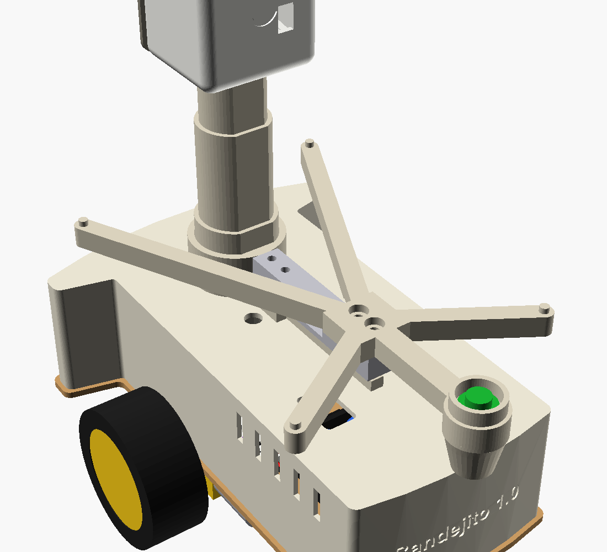
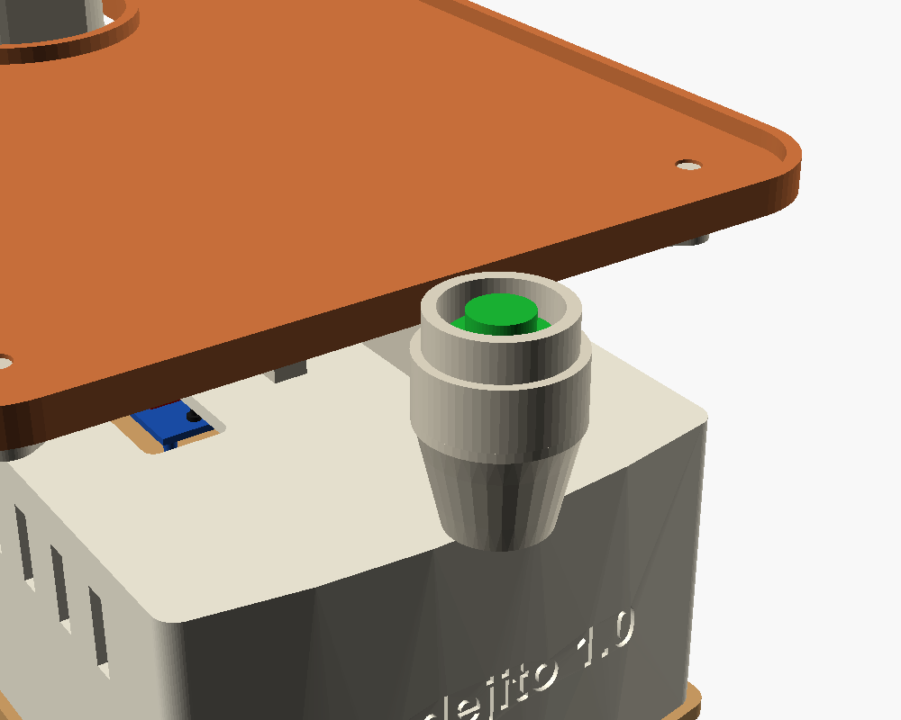

# Carcaça 3D: conceito B · Torre de Serviço

Modelo **paramétrico**: todas as medidas ficam no `medidas.txt`; o `GERAR.bat` gera as peças para o Fusion 360 (STEP), para a impressora (STL e bandejas `.3mf`) e o modelo do OpenSCAD.

> **Versão oficial** (desde 2026-10-16): **uma bandeja grande em cima de uma balança** (célula de carga de 500 g), botão verde no "nariz" da frente, coluna recuada, pilhas na frente, pé antitombo e portinhas de encaixe. A versão com 2 bandejas fica guardada no Git, na marca `bandejito-2-bandejas`.

## Como funciona: bandeja + balança + botão

O robô **sente o peso do pedido**. Quando o cliente tira o pedido da bandeja, a balança percebe e o robô volta ao balcão. O botão verde fica como reserva, para pedidos leves demais (ex.: um guardanapo).

| Balança sem a bandeja | Botão no "nariz" da frente |
|---|---|
|  |  |

O peso faz um caminho só, sem "vazar" para outras peças:

**bandeja → aranha → célula de carga → base da balança → coluna e saia**

| Peça | O que faz |
|---|---|
| **`bandeja`** (150 × 190 mm) | Uma só, grande, com um recorte em "U" atrás para a coluna (**2,5 mm de folga**: ela não encosta na coluna). Não tem fio nem parafuso: só encaixa nos 4 pininhos da aranha. Para lavar, **levante 3 mm e puxe para trás** |
| **`aranha`** (suporte em X) | Fica embaixo da bandeja e é parafusada (2 parafusos M4) na **ponta solta** da célula. Espalha o peso da bandeja inteira até a célula. O braço da frente vira o **"nariz"** que segura o botão verde e tem um canal por baixo para os fios dele |
| **Célula de carga 500 g** (comprada) | Barra de alumínio de 80 × 12,7 × 12,7 mm. Entorta um tantinho com o peso, e o módulo **HX711** transforma isso em gramas |
| **`base_balanca`** | Anel que abraça a coluna (com lado reto: não gira) + um pé que segura a **ponta presa** da célula (2 parafusos M4, com a cabeça escondida por baixo) + um **batente** embaixo da ponta solta |
| **`capo_botao`** | Copinho que encaixa por baixo do nariz e esconde o corpo do botão e os fios |

**Detalhes importantes:**
- **Nada pode encostar na bandeja nem na aranha** (só elas mesmas, a célula e o botão). Qualquer coisa encostando "rouba" peso e a balança erra. Por isso **não há braços decorativos** nem colar na coluna.
- **Batente:** um parafuso **M3 × 10** rosqueado no furo do batente, com a cabeça para cima, fica embaixo da ponta solta da célula. Ajuste com uma folga de **~0,3 mm** (a espessura de 3 folhas de papel). Se alguém apoiar a mão com força, a célula encosta no parafuso antes de entortar demais.
- **Fios:** os 4 fios da célula e os 2 do botão descem para dentro da saia por um **furo de 8 mm** no teto, ao lado do pé da balança. Deixe uma **folga (barriguinha)** nos fios entre a aranha e o furo: fio esticado também rouba peso.
- **Tara:** o peso da bandeja e da aranha (~100 g) é descontado pelo programa (a "tara"), que zera sozinho no balcão a cada viagem.
- **Limite:** ~380 g de pedido (500 g da célula − ~100 g da bandeja e da aranha, com margem). Para a maquete, sobra.
- **Câmera:** o aro do botão fica a 42° abaixo da câmera, então **não aparece no vídeo**.

## Conferências feitas (2026-10-16)

| Conferência | Resultado |
|---|---|
| Peças válidas | todas as 11 peças são 1 sólido válido |
| **Caminho do peso** | a bandeja encosta **só** na aranha; a aranha **só** na célula (no bloco rígido da ponta solta, y 30 a 52) e no capô; a célula **só** na base (na ponta presa) |
| Folgas | bandeja × coluna 2,5 mm · bandeja × base 10 mm · bandeja × saia 30 mm · aranha × base 14,8 mm · aranha × coluna 18 mm · capô × saia 3 mm |
| Protótipo (eletrônica e fios) | nenhum fio, placa ou pilha encosta nas peças novas |
| Bandejas de impressão (`.3mf`) | 4 bandejas, 11 peças dentro da mesa de 220 mm, com 3 mm entre as peças |
| Câmera (lente padrão de ~66°) | nada da bandeja nem do botão aparece no vídeo |
| OpenSCAD | atualizado com a mesma geometria |

### As portinhas de encaixe

- **Por fora:** só uma moldura fina (1,5 mm) em volta da abertura e um puxador embaixo. A de trás acompanha a curva da traseira.
- **Por dentro:** uma placa de reforço, uma **aba-gancho** em cima (fica atrás da parede) e **2 ressaltos** de 0,5 mm nas laterais (o "clique"). Na portinha lateral, os ressaltos ficam no meio da altura, porque embaixo, na frente, fica a aba de um parafuso da saia.
- **Fechar:** incline a portinha, encaixe a aba de cima atrás da parede e empurre a parte de baixo até o clique. **Abrir:** puxe o puxador para fora e solte a aba.
- **Ajuste:** se ficar dura, aumente `portinha_folga` (0,25) no `medidas.txt`; se ficar solta, diminua. Para não usar, `portinhas = false`.
- Imprimem **em pé** (a borda de baixo na mesa), sem suporte, ~20 g cada. Vale testar a lateral junto com a saia.

### Estabilidade

O robô se apoia nas rodas (atrás) e na roda boba (na frente). Ele só fica de pé se o **centro de massa** estiver **à frente do eixo das rodas**.

**Três proteções juntas:**
1. **Pilhas na frente**: puxam o centro de massa para a frente.
2. **Partida suave** no firmware: a roda já parte na força mínima e sobe até a máxima em 0,5 s, em vez de dar o tranco. Parar e frear continuam imediatos.
3. **Pé antitombo**: se mesmo assim ele empinar, o pé encosta no chão a 5,2°, antes do ponto de tombar, e o robô volta para a roda boba.

Com uma bandeja só, o peso fica **baixo**: a bandeja, a aranha e a balança ficam logo acima da saia. Coloque os pedidos de preferência **na frente da coluna**.

## Arquivos

| Arquivo | O que é |
|---|---|
| **`medidas.txt`** | **O painel de números.** Todas as medidas ficam aqui |
| **`GERAR.bat`** | Dois cliques: lê `medidas.txt` e gera tudo de novo, inclusive o protótipo (~1 min) |
| `step/*.step` | As 11 peças + `montagem.step` (robô inteiro, com a célula de carga) para o **Fusion 360** |
| `stl/*.stl` | As 11 peças avulsas para o fatiador (Cura, Bambu Studio, PrusaSlicer) |
| `impressao/` | **Bandejas prontas**: as peças já arrumadas na mesa da impressora (`.3mf` + `.stl` + `.step`) |
| `bandeja_3mf.py` | Arruma as peças nas bandejas e grava os `.3mf` (usado também pela maquete) |
| `robo_garcom_carcaca.scad` | O mesmo modelo no OpenSCAD (o `GERAR.bat` copia as medidas para ele) |
| `gerar.py` | O programa que desenha as peças (CadQuery, Python) |
| `prototipo.py` | Monta o **protótipo demonstrativo** (robô completo, com eletrônica, fios, balança e botão) em `step/prototipo_completo.step` |
| `imagens/` | Robô completo, balança, botão, montagem, perfil, eletrônica por dentro, cabeça em corte, saia por baixo |

## Como mudar uma medida (jeito principal)

1. Abra `medidas.txt` no Bloco de Notas (dois cliques).
2. Mude o número depois do `=`. Pode usar vírgula ou ponto: `40,5` ou `40.5`.
3. Salve (**Ctrl+S**).
4. Dê dois cliques em **`GERAR.bat`**. Uma janela preta mostra cada peça sendo gerada e termina com `pronto`.
5. Os arquivos novos estão em `step\` (Fusion) e `stl\` (impressora).

> Se aparecer `[ERRO]`, a mensagem diz a linha de `medidas.txt` com problema (ex.: faltou o `=` ou tem letra no lugar do número).

> **Quando a célula de carga chegar**, meça com régua o comprimento, a largura e a distância dos furos até as pontas, e veja se os parafusos são M4 ou M3. Coloque os números em `celula_comprimento`, `celula_lado`, `celula_furo_1`, `celula_furo_2` e `celula_parafuso` e rode o `GERAR.bat`.

## Abrir no Fusion 360

1. No Fusion: **Arquivo → Abrir → Abrir do meu computador** (*Open from my computer*).
2. Escolha `step\montagem.step` (robô inteiro) ou uma peça, por exemplo `step\cabeca.step`.
3. As peças chegam como **sólidos de verdade** (faces, furos e curvas editáveis). Dá para medir, cortar e empurrar/puxar faces.
4. O STEP não guarda a lista de medidas. Para mudar um número, use o `medidas.txt` + `GERAR.bat` e abra o STEP novo.

> As peças avulsas (`saia.step`, `cabeca.step`...) vêm na **posição de impressão**. O `montagem.step` vem com tudo no lugar.

> ⚠️ Mudanças feitas **dentro** do Fusion não voltam para o `medidas.txt`. Se gerar de novo, elas são substituídas.

## As 11 peças

| Peça | Tamanho (mm) | Como imprimir |
|---|---|---|
| `cabeca.stl` | 52 × 68 × 48 | **Imprima primeiro (teste).** Cara virada para a mesa |
| `cabeca_tampa.stl` | 52 × 68 × 39 | Tampa deitada na mesa |
| `tampa_traseira.stl` | 78 × 11 × 49 | Em pé (a borda de baixo na mesa), sem suporte |
| `tampa_lateral.stl` | 8 × 70 × 49 | Em pé (a borda de baixo na mesa), sem suporte |
| `capo_botao.stl` | 24 × 24 × 22 | Em pé (o fundo na mesa), sem suporte |
| `saia.stl` | 150 × 212 × 55 | De cabeça para baixo (teto na mesa). Precisa de uma mesa de pelo menos 220 × 220 mm |
| `bandeja.stl` | 150 × 190 × 6 | Deitada. Cabe numa mesa de 220 × 220 mm |
| `coluna.stl` | Ø36 × 125 | Em pé |
| `pe_antitombo.stl` | 36 × 16 × 60 | Em pé (o perfil na mesa), sem suporte |
| `aranha.stl` | 124 × 198 × 15 | Deitada (o lado liso, que encosta na célula, na mesa). Os canais de baixo fazem "pontes" curtas: não precisa de suporte |
| `base_balanca.stl` | 43 × 121 × 20 | Deitada (o lado que encosta na saia na mesa), sem suporte |

Altura total montada: cerca de **224 mm**.
Configuração sugerida: PLA, camada de 0,2 mm, 3 paredes, preenchimento de 15%, **sem suportes**. Para a **aranha** e a **base da balança**, use **4 paredes e 30% de preenchimento**: são elas que seguram o peso.

## Bandejas prontas para imprimir (pasta `impressao\`)

Cada arquivo é **uma impressão**, com as peças já arrumadas numa mesa de **22 × 22 cm**, na ordem combinada:

| Arquivo | O que imprime |
|---|---|
| `1_cabeca_e_tampa_TESTE` | Cabeça + tampa (**imprima primeiro**, como teste, depois de medir a placa) + as 2 portinhas + o capô do botão |
| `2_saia` | A saia (depois de medir a base do kit) |
| `3_bandeja_coluna_e_pe` | Bandeja + coluna + pé antitombo |
| `4_aranha_e_base_da_balanca` | Aranha + base da balança (**depois de medir a célula de carga**) |

- Abra o **`.3mf`** no fatiador: as peças chegam separadas e no lugar. O **`.stl`** de mesmo nome é a bandeja inteira num arquivo só (reserva).
- O **`.step`** de mesmo nome tem as mesmas peças sólidas e posicionadas: abre no **Fusion 360**, no **Bambu Studio** e no **Orca Slicer**.
- **`0_TODAS_AS_BANDEJAS_so_para_conferir.step`**: todas as bandejas lado a lado, sobre mesas cinza, só para conferir no Fusion (não imprimir).
- Mesa maior? Mude `mesa_impressora` no `medidas.txt` e rode o `GERAR.bat`.
- ⚠️ Enquanto houver medidas "MEDIR" no `medidas.txt`, estas bandejas são só para conferência: **não imprima a saia, a cabeça nem a aranha antes de medir as peças reais**.

## Protótipo demonstrativo (robô completo com eletrônica e fios)

`step/prototipo_completo.step` mostra o robô **pronto**: carcaça, chassi, rodas, motores, baterias, LM2596, protoboard, driver, ESP32-CAM, **todos os fios**, a célula de carga e o botão, seguindo o `manual_montagem_fisica.md` (Etapas 6 a 8). **Não é para imprimir.** Serve para entender onde fica cada coisa e por onde passa cada fio. O `GERAR.bat` gera esse arquivo de novo junto com as peças.

| Robô pronto | Carcaça transparente |
|---|---|
|  |  |

| Fiação (sem a carcaça) | Visto de cima | ESP32-CAM na cabeça |
|---|---|---|
|  |  |  |

### Como ver no Fusion 360

1. **Arquivo → Abrir → Abrir do meu computador** → `step\prototipo_completo.step`.
2. À esquerda fica o **Navegador** (*Browser*). Abra **Componentes**: o robô está dividido em 6 grupos:
   `1_carcaca` · `2_chassi_rodas_motores` · `3_energia` · `4_controle` · `5_fios` · `6_balanca_e_botao`.
3. Clique no **olho** 👁 ao lado de `1_carcaca` para escondê-la. Aparece tudo o que fica por dentro.
4. Abra um grupo (setinha ▸) para esconder ou mostrar peças avulsas, por exemplo um fio só.
5. Para medir: **Inspecionar → Medir** (tecla **I**).

### Legenda dos fios (cor no modelo → ligação)

| Cor | Fio no modelo | Liga | Passo do manual |
|---|---|---|---|
| 🔴 Vermelho | `01`, `03`, `08` | Bateria (+), LM2596 IN+, driver + → **linha 1 (+BAT 7,4 V)** | 6.1, 6.3, 7.2 |
| ⚫ Preto | `02`, `04`, `06`, `09` | Bateria (−), LM2596 IN− e OUT−, driver − → **linha 3 (GND)** | 6.2, 6.4, 6.6, 7.2 |
| ⚫ Preto curto | `07` | Ponte 3e → 3f: liga as duas metades da linha 3 (GND tem muitos fios) | 6, observação |
| 🟠 Laranja | `05` | LM2596 OUT+ (5,0 V) → **linha 5 (+5V)** | 6.5 |
| 🟠 Laranja | `12_esp_5V` | ESP32-CAM **5V** → linha 5 | 8.5 |
| ⚫ Preto | `12_esp_GND` | ESP32-CAM **GND** → linha 3 (metade f-j) | 8.5 |
| 🟡 Amarelo | `12_esp_IO14` | IO14 → driver **IN1** (motor esquerdo) | 8.3 |
| 🟢 Verde | `12_esp_IO15` | IO15 → driver **IN2** (motor esquerdo) | 8.3 |
| 🔵 Azul | `12_esp_IO13` | IO13 → driver **IN3** (motor direito) | 8.3 |
| 🟣 Roxo | `12_esp_IO12` + `10` | IO12 → **linha 7** → driver **IN4**, com o resistor 10 kΩ da linha 7 ao GND | 8.4 |
| 🔴⚫ Finos | `11_motor_...` | Motor esquerdo → **MOTOR-A**, motor direito → **MOTOR-B** (soldados) | 7.2 |

Na protoboard, as faixas coloridas marcam as linhas usadas: vermelha = linha 1, preta = linha 3, laranja = linha 5, roxa = linha 7. O capacitor de 470 µF (cilindro azul-escuro) fica entre a linha 5 (+) e a linha 3 (−).

Os 6 fios da ESP32-CAM **descem por dentro da coluna oca**. Esconda `1_carcaca` para vê-los. Os fios da balança e do botão (HX711, Fase 5) ainda não estão no modelo.

### O que é só ilustrativo

- Os componentes são **blocos simplificados**, com medidas de anúncio ou estimadas.
- **A ordem dos pinos da ESP32-CAM e do driver no modelo é ilustrativa.** Na montagem real, confira sempre pelo **nome impresso** na placa (manual, 8.1).
- O contorno da base veio da foto do anúncio (comprimento e larguras são as cotas da foto). As curvas da frente e de trás, as posições da eletrônica, das rodas, dos furos e da chave são estimativas marcadas "MEDIR" no `medidas.txt`: confira com régua antes de imprimir a saia.
- Frente do robô = **lado para onde a câmera olha** (onde está o nome). Nesta carcaça, os motores ficam **atrás** e a roda boba na frente.

## Como montar

0. **Antes da saia:** parafuse o **pé antitombo** embaixo da traseira da base com 2 parafusos M3 × 10, de cima para baixo (a ponta redonda para baixo, atrás das rodas). Monte a eletrônica (manual, Etapa 8.6): **pilhas na frente**, com a chave do suporte do lado direito, embaixo do furo da chave da saia.
1. A saia é parafusada no chassi com **4 parafusos M3 de baixo para cima**: passam pelos furos da base e rosqueiam direto no plástico (furo de 2,8 mm). A base tem muitos furos; se nenhum coincidir com os da saia, dá para furar a base com broca de 3 mm (acrílico racha: devagar, sem pressão, com fita crepe por cima e madeira por baixo).
2. A coluna encaixa na saia, perto da traseira. O lado reto impede que ela gire.
3. **Monte a balança na bancada, antes de pôr na coluna:**
   1. prenda a **ponta presa** da célula no pé da `base_balanca` com 2 parafusos M4 × 12, **de baixo para cima** (a cabeça fica escondida no rebaixo). A **seta** gravada na célula aponta para **baixo**, e o lado dos fios fica na ponta presa;
   2. rosqueie o parafuso-batente M3 × 10 no furo do batente, deixando ~0,3 mm entre a cabeça dele e a célula;
   3. prenda a `aranha` na **ponta solta** com 2 parafusos M4 × 12, **de cima para baixo** (a cabeça fica no rebaixo de cima, abaixo da bandeja). O nariz aponta para a frente.
4. Desça a base da balança pela coluna até ela assentar no teto da saia, com a aranha apontando para a frente. Passe os fios da célula pelo furo de 8 mm do teto da saia.
5. **Botão:** coloque o botão verde de cima para baixo no furo do nariz, aperte a porca por baixo, solde (ou encaixe) os 2 fios, passe-os pelo canal embaixo do braço da frente até o meio da aranha e daí, com uma folga, até o furo do teto da saia. Encaixe o `capo_botao` por baixo do nariz.
6. **Bandeja:** encaixe o recorte em volta da coluna e baixe até ela assentar nos 4 pininhos da aranha. Confira se ela não encosta na coluna (folga dos dois lados).
7. A ESP32-CAM entra pela parte de trás da cabeça, encostada nos 4 apoios. A tampa de trás encaixa por pressão e o pino dela segura a placa.
8. A cabeça encaixa no topo da coluna. Os 6 fios sobem pelo canal oco (18 mm).

## Ver no OpenSCAD (alternativa, com o Customizer)

1. Abra `robo_garcom_carcaca.scad` no OpenSCAD.
2. Menu **Janela** (*Window*) → desmarque **Ocultar Customizer** (*Hide Customizer*).
3. Mude o número, aperte **F5** para ver.
4. Em **peca**, escolha a peça. Aperte **F6** (renderizar) e depois **F7** (exportar STL).

> O Customizer muda as medidas **só na tela**: não altera o `medidas.txt`. Se gostar de um valor, copie-o para o `medidas.txt` e rode o `GERAR.bat`.

> Nunca use "escala" (110%) no fatiador: ela muda também os furos e os encaixes.

## Medidas: o que já é real e o que falta medir

| Medida | Situação |
|---|---|
| Base (acrílico com papel protetor marrom): 212 mm de comprimento, corpo de 100 mm, leque de 150 mm | ✅ Da foto do anúncio (2026-10-14) |
| Curva da frente, começo do leque e pontas do leque | 🟡 Estimados pela foto (MEDIR) |
| Regulador 66 × 35 × 13 mm | ✅ Do anúncio |
| Protoboard 45 × 34 × 8,5 mm | ✅ Do anúncio |
| ESP32-CAM 27 × 40,5 mm | ✅ Medida padrão da placa |
| Suporte 2×18650 ≈ 78 × 41 × 25 mm | 🟡 Calculado pela foto (pilha 18 × 65 mm) |
| **Célula de carga 500 g** (80 × 12,7 × 12,7 mm, furos M4 a 5 e 15 mm das pontas) | ⚠️ **MEDIR** quando chegar (antes de imprimir a aranha e a base da balança) |
| **Furos da saia na base** (frente ±38/+88, trás ±56/−88) | ⚠️ **MEDIR** (ou furar a base) |
| **Posição e altura do eixo das rodas** | ⚠️ **MEDIR** (as 3 fotos dão entre ~12,3 e ~13,5 cm da frente; modelo usa 13,5. Rodas a ±65 mm do meio) |
| **Posição da chave liga/desliga** | ⚠️ **MEDIR** |
| **Posição da lente e do LED de flash na placa** | ⚠️ **MEDIR** (antes de imprimir a cabeça) |
