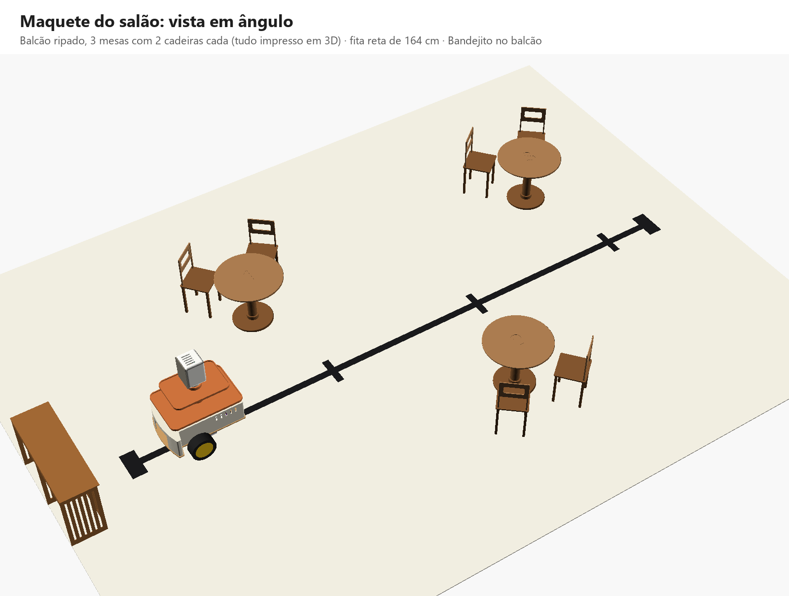
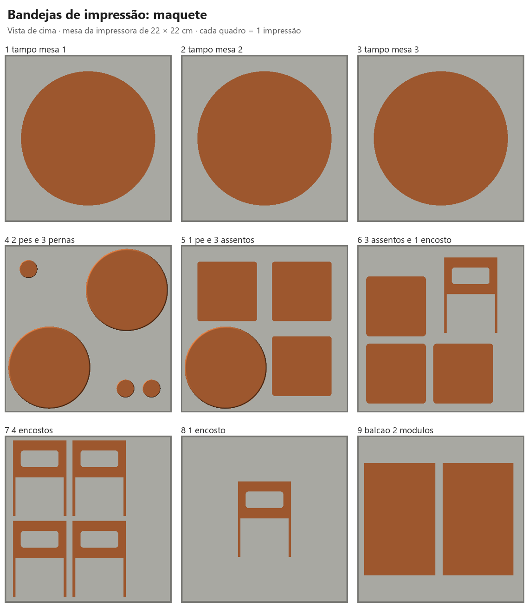
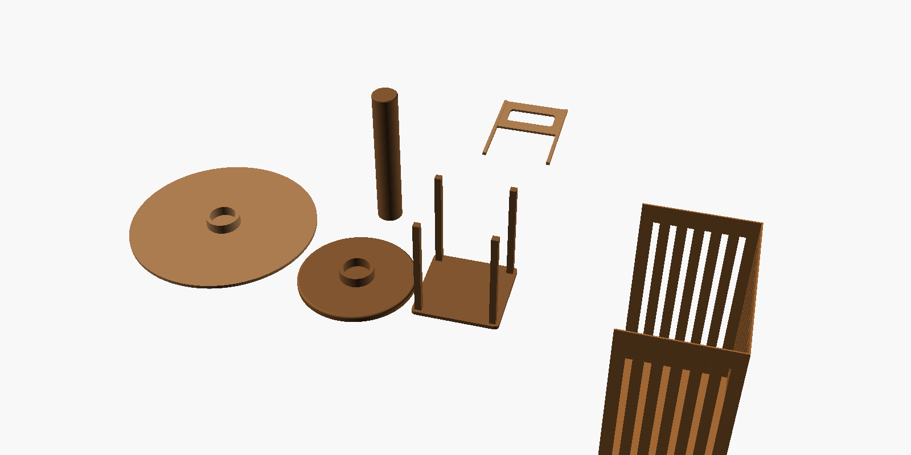
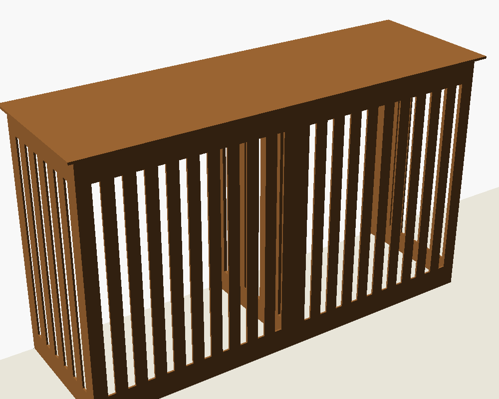
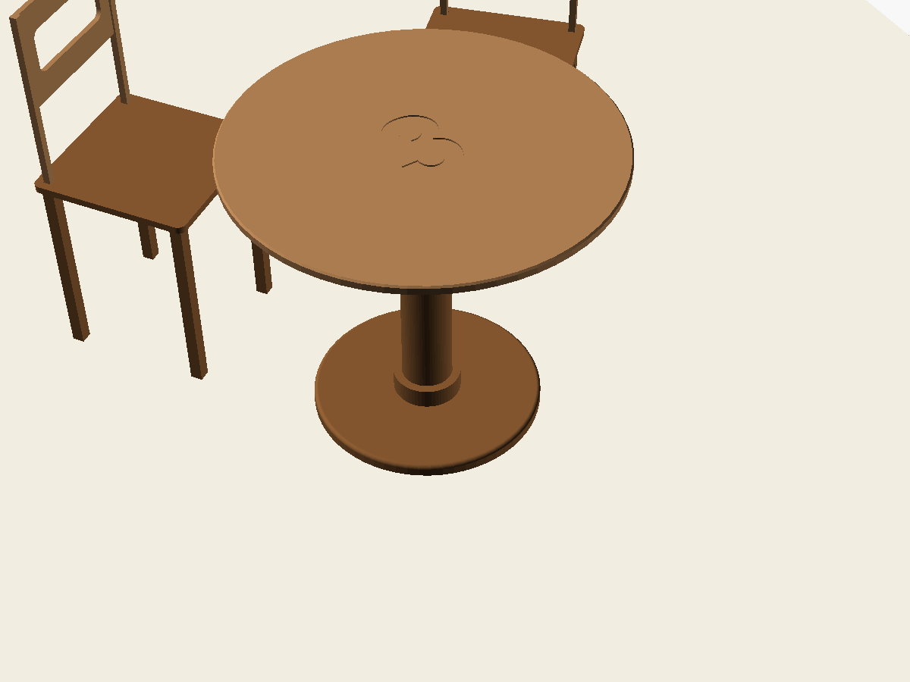

# Maquete do salão (impressão 3D)

Mesas, cadeiras e balcão para o "salão" em miniatura da Fase 5, na proporção do Bandejito. Tudo sai de **um projeto só**: um `medidas.txt` e um `GERAR.bat`.

## Por que esses tamanhos

O Bandejito tem ~27 cm de altura. Um robô garçom de verdade tem ~1,25 m, então a maquete fica na **escala ~1 : 4,6**:

| | Restaurante real | Maquete |
|---|---|---|
| Mesa | 75 cm de altura, tampo de 80 cm | **15 cm**, tampo de **18 cm** |
| Cadeira | assento a 45 cm, encosto até 90 cm | assento a **10 cm**, encosto até **19 cm** |
| Balcão | ~80 cm | **17 cm** |

A mesa (15 cm) fica **um pouco acima da bandeja do robô** (13,5 cm do chão) e o balcão (17 cm) também: o cliente e o garçom pegam o pedido sem se abaixar, como nos robôs garçons de verdade.

## Bandejas prontas para imprimir (pasta `impressao\`)

Cada arquivo é **uma impressão**: as peças já estão arrumadas e espaçadas numa mesa de **22 × 22 cm**.

| Arquivo | O que imprime |
|---|---|
| `1_tampo_mesa_1`, `2_...`, `3_...` | Um tampo cada |
| `4_2_pes_e_3_pernas` | 2 pés + as 3 pernas |
| `5_1_pe_e_3_assentos` | O 3º pé + 3 assentos |
| `6_3_assentos_e_1_encosto` | 3 assentos + 1 encosto |
| `7_4_encostos` | 4 encostos |
| `8_1_encosto` | O último encosto |
| `9_balcao_2_modulos` | Os 2 módulos do balcão (precisa de 170 mm de altura) |

- Abra o **`.3mf`** no fatiador (Cura, PrusaSlicer, Bambu Studio, Orca): as peças chegam separadas e no lugar. **Não gire** nem use "organizar automaticamente" (*arrange*), a não ser que queira.
- O **`.stl`** de mesmo nome é a bandeja inteira num arquivo só (para fatiadores que não abrem `.3mf`).
- O **`.step`** de mesmo nome tem as mesmas peças, sólidas e no mesmo lugar: abre no **Fusion 360** e também no **Bambu Studio** e no **Orca Slicer**, que imprimem direto de `.step`.
- **`0_TODAS_AS_BANDEJAS_so_para_conferir.step`**: todas as bandejas lado a lado, cada uma sobre uma mesa cinza, para conferir no Fusion. **Não imprima esse** (a mesa cinza é só referência).
- Impressora com mesa maior? Mude `mesa_impressora` no `medidas.txt` (Bambu A1/P1 = 256) e rode o `GERAR.bat`: as peças se espalham na mesa nova.
- Se mudar quantidades (`mesas`, `cadeiras_por_mesa`, `balcao_modulos`), o programa faz **uma bandeja por peça** (sempre cabe).
- O programa confere sozinho se tudo cabe na mesa e se nenhuma peça encosta na outra.

## As peças (tudo sem suporte)

| Arquivo (`stl\`) | Tamanho (mm) | Quantas | Como imprimir |
|---|---|---|---|
| `tampo_mesa_1`, `_2`, `_3` | 180 × 180 × 14 | 1 de cada | De cabeça para baixo (o número gravado fica na mesa da impressora) |
| `perna` | Ø24 × 140 | 3 | Em pé |
| `pe` | Ø110 × 16 | 3 | Deitado |
| `cadeira_assento` | 80 × 80 × 100 | 6 | De cabeça para baixo (pernas para cima) |
| `cadeira_encosto` | 72 × 102 × 4 | 6 | Deitado |
| `balcao_modulo` | 95 × 150 × 170 | 2 | De cabeça para baixo (o tampo na mesa da impressora) |

- Configuração sugerida: PLA, camada de 0,2 mm, 3 paredes, 15% de preenchimento, sem suportes.
- Tudo cabe numa impressora de 220 × 220 mm. O balcão precisa de **170 mm de altura** de impressão.
- PLA estimado (o `GERAR.bat` mostra os valores atualizados): mesas ~330 g, cadeiras ~260 g, balcão ~180 g, **total ~760 g**. O fatiador dá o valor exato.
- Para gastar menos: `cadeiras_por_mesa = 1` (economiza ~130 g) ou imprima só as mesas.

### Balcão econômico

Uma caixa fechada desse tamanho, impressa do jeito comum, gastaria perto de **1 kg** de PLA. Este balcão gasta **~90 g por módulo** porque:
- é **oco**, com paredes finas de 1,2 mm (3 voltas do bico de 0,4 mm);
- **não tem fundo** nem **parede de trás** (o lado que ninguém vê); uma travessa no alto deixa firme;
- a frente e os lados são **ripados** (frestas de 5 mm entre ripas de 8 mm);
- são **2 módulos iguais** lado a lado: o mesmo arquivo impresso 2 vezes (um balcão de 28 cm não caberia na impressora).

## Como montar

- **Mesa:** encaixe a perna no pé e o tampo em cima da perna (por pressão).
- **Cadeira:** encaixe os 2 postes do encosto nos 2 furos das pernas de trás do assento.
- **Balcão:** coloque os 2 módulos lado a lado, com a parte aberta virada para a parede (para longe da fita). Se quiser, uma fita dupla face entre eles.
- Se um encaixe ficar frouxo, uma gota de cola instantânea resolve. Se ficar apertado demais, aumente `folga` no `medidas.txt` e gere de novo.
- Onde colocar cada peça: `GUIA_PASSO_A_PASSO.md`, Fase 5, "Como montar a maquete". As cadeiras ficam do **lado oposto à fita**, fora da faixa livre do giro.

## Como mudar uma medida

1. Abra `medidas.txt` (dois cliques), mude o número e salve (**Ctrl+S**).
2. Dê dois cliques em **`GERAR.bat`**.
3. Os arquivos novos aparecem em `stl\` (impressora) e `step\` (Fusion 360).

O **`step\maquete_completa.step`** é o salão inteiro montado: tapete, fita, balcão, mesas, cadeiras e o Bandejito completo (com a eletrônica), parado no balcão. No Fusion, o Navegador mostra 2 grupos: `1_salao` e `2_bandejito`.

Opções úteis:
- `mesa_formato = "quadrada"`: mesas quadradas;
- `mesas = 4`: gera também o tampo da mesa 4;
- `numero_tamanho = 0`: tampo liso;
- `encosto_vao = false`: encosto liso;
- `ripa_vao = 0`: balcão com paredes lisas (gasta mais).

> **Mesa maior?** A borda da mesa precisa ficar a **~19 cm da fita** (15 cm livres para o giro do robô + folga). Se aumentar o tampo, afaste o meio da mesa da fita na mesma medida que o raio cresceu.
